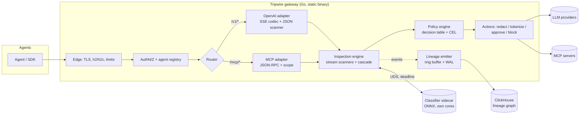

# Tripwire — inline AI data-security gateway

> A Go proxy that sits between agents and the models and MCP tools they call. It inspects every prompt, tool argument and tool result in under 10 ms, redacts / tokenizes / blocks / escalates sensitive data, and records lineage: where each value came from and where it went.

| | |
|---|---|
| **Language** | Go (toolchain pinned to Go 1.26.x; see [ARCHITECTURE §12](docs/ARCHITECTURE.md#12-performance-engineering)) |
| **Surfaces** | OpenAI-compatible HTTP (Chat Completions, Responses API subset), MCP over Streamable HTTP (revisions `2026-07-28` and `2025-11-25`) |
| **Latency contract** | ≤ 10 ms added at p99 (hard SLO), ≤ 5 ms target at the headline load (single-digit-ms p99), **while streaming** |
| **Throughput contract** | 20 K requests/s with streaming responses on a 3-VM rig (workload defined in [§6](#6-performance-contract-and-how-it-is-proven)) |
| **Lineage** | Value-level provenance graph in ClickHouse, 1 M lineage events/s ingest |
| **Status** | Phase 0 complete on a synthetic rig (shape-only). Phase 1 (core proxy, streaming plumbing, authentication, lineage skeleton) implemented and tested; ClickHouse probe and TypeScript SDK check open; no detectors yet. Every `[measured]` below is a placeholder that is filled by `make bench` from raw result files, never by hand. |
| **Companion docs** | [ARCHITECTURE.md](docs/ARCHITECTURE.md) · [IMPLEMENTATION_PLAN.md](docs/IMPLEMENTATION_PLAN.md) · (generated per repo) `DESIGN.md`, `BENCHMARKS.md`, `FAILURES.md` |

---

## Table of contents

1. [What Tripwire is, and the problem it solves](#1-what-tripwire-is-and-the-problem-it-solves)
2. [What it does (feature set)](#2-what-it-does-feature-set)
3. [What it deliberately does not do](#3-what-it-deliberately-does-not-do)
4. [How it works in one page](#4-how-it-works-in-one-page)
5. [Quick start (target interface)](#5-quick-start-target-interface)
6. [Performance contract and how it is proven](#6-performance-contract-and-how-it-is-proven)
7. [Correctness contract: precision and recall](#7-correctness-contract-precision-and-recall)
8. [Configuration at a glance](#8-configuration-at-a-glance)
9. [Repository layout](#9-repository-layout)
10. [Threat model summary](#10-threat-model-summary)
11. [Evidence trail: the four files every release ships](#11-evidence-trail-the-four-files-every-release-ships)
12. [Honesty rules](#12-honesty-rules)
13. [Glossary](#13-glossary)

---

## 1. What Tripwire is, and the problem it solves

Agents now move data between three kinds of parties: **models** (hosted by someone else), **tools** (MCP servers, many of them third-party and most less than a year old), and **users**. Every hop is a place where a card number, an API key, a customer record or a private source file can leave the trust boundary. The failure is rarely a human typing a secret into a chat box. It is an agent that reads a file with a secret in it, includes that file in the next prompt, and then calls a tool with part of it as an argument. Or a tool result that carries instructions aimed at the model, which then exfiltrates something else through a different tool.

Existing options leave a gap:

- **Plain LLM gateways and MCP gateways** route, authenticate and observe. Most do not look *inside* a tool call, and fewer still do so on a streaming path without buffering whole responses.
- **Endpoint DLP** sees files and clipboards, not the argument of a `tools/call` or the middle of an SSE stream.
- **Provider-side guardrails** run after your data has already left your boundary, and are per-provider.

Tripwire is the **in-path enforcement point you own**. Its design constraint is that security inspection must be cheap enough to leave switched on: a gateway that adds tens of milliseconds, or blocks too much, gets bypassed, and a bypassed gateway is worse than none because it creates false assurance. Everything in the design follows from three numbers: **< 10 ms p99 added latency, precision high enough that the false-positive rate stays tolerable, and lineage rich enough that an investigator can answer "where did this value go?"**

This is the product Cyberhaven shipped in 2026 (Agentic AI Security, linking every agent action to the data it touched through lineage), reduced to a system one engineer can build, load-test, and publish reproducible numbers for.

## 2. What it does (feature set)

Every item below maps to a line in the project brief ("what you build", "the hard parts", "proof plan").

### 2.1 Proxy (Go)

| Capability | Detail |
|---|---|
| OpenAI-compatible endpoints | `POST /v1/chat/completions` (stream and non-stream) first; `POST /v1/responses` (typed SSE events) second; `GET /v1/models` passthrough with agent-scoped filtering. Works against any OpenAI-compatible upstream (hosted providers, vLLM, llama.cpp server). |
| MCP endpoints | Streamable HTTP, **both** the stateless `2026-07-28` revision and the session-based `2025-11-25` revision. Transparent-but-semantic: the gateway parses JSON-RPC, enforces scope, and rewrites `tools/list`, but does not terminate or aggregate servers. |
| Streaming (SSE) inspection **without buffering whole responses** | Incremental SSE codec, zero-allocation JSON delta scanner, resumable detector state per stream, bounded **hold-back** window, per-event rewrite. A response is never fully buffered unless an operator explicitly selects `buffered` mode for a route. |
| Per-agent identity | JWT (EdDSA, JWKS cached with stale-if-error), mTLS, or hashed static keys. Every request resolves to `(tenant, agent, groups, clearances)` in under 100 µs on the hot path. |
| Tool scoping | Per-agent allow-lists over MCP servers, tool names, and (optionally) argument constraints. `tools/list` is filtered, `tools/call` is gated, tool descriptions are pinned by hash to catch "rug pull" changes. |
| Credential brokering | Agents never hold provider keys or MCP server tokens; the gateway injects them on egress and refuses token pass-through. |

### 2.2 Detection cascade

Cheapest stage first; later stages run only when earlier ones are unsure *and* the latency budget allows.

1. **Stage 1: structural detectors and validators.** Hand-written byte-class state machines (not backtracking regexes) with checksum validators: Luhn + IIN ranges for card numbers, IBAN mod-97, ABA routing checksum, Verhoeff for Aadhaar, SSN structural rules, known-prefix secret formats, JWT structure, PEM blocks, URL-embedded credentials, context-keyword boosting.
2. **Stage 2: dictionary and entity matching.** Aho–Corasick over tenant dictionaries (customer names, project codenames, internal hostnames) and a **session-literal automaton** built from values already tagged in the current session. Gazetteer plus context heuristics for names and addresses.
3. **Stage 3: small ONNX classifier**, called only on the uncertain band, in an **isolated sidecar process** with its own CPU set, with a hard deadline. Used for entity recognition on ambiguous spans, high-entropy "is this a secret" decisions, and prompt-injection scoring.

### 2.3 Policy

Actions: `allow`, `redact`, `tokenize`, `require_approval`, `block`. Decided per **data class × agent (group) × destination × direction**. Each rule runs in `enforce`, `monitor` or `shadow` mode, so precision can be tuned on real traffic before anything is blocked. Fail-open versus fail-closed is explicit per class and per failure type.

`tokenize` is reversible: the model sees a stable token; a tool that is cleared for the class receives the real value on egress. This is what lets an agent do useful work on data it is not allowed to read.

### 2.4 Lineage

Values are **tagged at their source** (file read, database row, tool result, user input, model output), tags are **carried through prompts and tool calls** by keyed value fingerprints, and the resulting graph is stored in **ClickHouse** for investigation. Two edge classes are recorded and kept distinct: `EXACT` (the fingerprinted value appears verbatim in the sink) and `CONTEXT` (the sink call happened in a session whose context contained the tag). Policy can act on either, with different thresholds.

### 2.5 Injection defence

Tool results (and retrieved content, and tool *descriptions*) are scored for instructions aimed at the model: signature heuristics, hidden-character detection, markdown/URL exfiltration patterns, and an optional small classifier. A hit records **which tool introduced it** and links to the lineage graph, so policy can express rules like "once this session has seen flagged untrusted content *and* holds `SECRET` tags, any call to an external-destination tool requires approval."

## 3. What it deliberately does not do

State these in interviews before someone else finds them.

- **It is not a model-safety filter.** It does not judge toxicity, bias or factuality.
- **It cannot see inside the model.** Lineage is *provenance by value fingerprint plus session context*, not taint tracking through the weights. A paraphrased secret is not an `EXACT` edge. See [ARCHITECTURE §10.4](docs/ARCHITECTURE.md#104-what-lineage-can-and-cannot-claim).
- **It does not inspect images, audio or opaque binary attachments.** They are subject to allow / block per agent and size cap only.
- **It does not terminate TLS for arbitrary third parties.** Agents point at the gateway; the gateway terminates TLS for itself and originates TLS upstream.
- **It does not proxy stdio MCP servers** directly. A stdio server can be fronted by a small adapter, which is out of scope here.
- **Bypass is a deployment question.** If an agent can reach a provider directly, no gateway can help. Tripwire ships the egress-policy guidance (and detects hosted-MCP bypass in Responses API requests), but enforcement of network egress is the platform's job.
- **WebSocket transports** (for example a Responses WebSocket mode) are rejected at the edge, not inspected, until they are explicitly implemented.

## 4. How it works in one page



**Request path in words.** Authenticate → classify the surface (OpenAI / MCP) → parse with the zero-allocation scanner → inspect only *new* content (per-message cache) → evaluate policy → rewrite by splicing edits into the original bytes → forward → on the response, run a resumable scanner per stream, holding back only the bytes that could still become part of a match → emit lineage events off the data path.

**The one idea that makes streaming work.** A card number split across two SSE events (`"4111 11"` then `"11 1111 1111"`) is the *normal* case with token-level streaming, not an edge case. Detectors are therefore explicit state machines whose state lives with the stream. Bytes that belong to a still-open candidate are **held back** (bounded to ≈ 32 B per choice for structural classes) and released or rewritten when the candidate resolves. Nothing that could be part of a match has been sent when the match is confirmed. The hold-back tiers, and what each costs in latency, are specified in [ARCHITECTURE §5.4](docs/ARCHITECTURE.md#54-hold-back-tiers-the-hard-part).

## 5. Quick start (target interface)

> This is the interface the implementation plan converges on. **Phase 0 (measurement harness) is implemented; the gateway is not** (Phase 1). Targets and flags that do not exist yet fail loudly instead of pretending.
>
> **Works today** (see [docs/phases/P0.md](docs/phases/P0.md)):
> `make test` · `make lint` · `make vuln` · `make fuzz-smoke` · `make selfcheck-laptop` · `make bench-quick` (single-box, shape-only) · `make build` (`twmock`, `twnull`, `twload`, `twfit`) · `make rig-up/rig-down` (bring-your-own hosts; see [deploy/rig](deploy/rig/README.md)).
> **Not yet:** `tripwire` gateway, `twctl`, `tweval`, `twclf`, `make dev-up` end-to-end (compose file is unvalidated), `make eval/bench/repro/failures`.

```bash
# 1. Toolchain: Go 1.26.x, Docker, make
git clone https://example.invalid/tripwire && cd tripwire     # repo URL assigned at creation
make tools                       # pinned linters, govulncheck, buf, ClickHouse client

# 2. Local dev stack: gateway + mock LLM + mock MCP + ClickHouse + Prometheus/Grafana/Tempo
make dev-up

# 3. Point an agent at the gateway instead of the provider
export OPENAI_BASE_URL=http://localhost:8443/v1
export OPENAI_API_KEY=tw_agent_key_demo          # a Tripwire agent credential, NOT a provider key

# 4. Send something that should be caught
curl -sN $OPENAI_BASE_URL/chat/completions \
  -H "Authorization: Bearer $OPENAI_API_KEY" -H 'Content-Type: application/json' \
  -d '{"model":"mock-1","stream":true,
       "messages":[{"role":"user","content":"my card is 4111 1111 1111 1111, summarize my order"}]}'
# expected: upstream receives "[REDACTED:PCI.PAN]" (or a token), the client sees a normal stream,
#           and `twctl lineage trace --session <id>` shows the tag and the redaction decision

# 5. Investigate
twctl lineage forward  --tag <tag-id>        # where did this value go?
twctl lineage backward --sink <call-id>      # where did this tool argument come from?
twctl policy shadow-report --since 1h        # what would enforcement have blocked?

# 6. Prove it
make bench-quick                 # 60-second sanity run on one box
make bench                       # full run, 3-VM rig, regenerates every chart from raw data
make eval                        # precision/recall per class on the frozen adversarial set
make fuzz FUZZTIME=10m           # all fuzz targets
make failures                    # failure-injection suite (toxiproxy, tc netem, kill -9, SIGSTOP)
```

## 6. Performance contract and how it is proven

### 6.1 Definitions (written before any measurement, per the benchmark-hygiene rule)

| Term | Definition |
|---|---|
| **Added latency, request path** | Time from the gateway receiving the last byte of a request to forwarding the first byte of the (possibly rewritten) request upstream, measured externally and cross-checked internally. |
| **Added latency, stream path (per event)** | For each SSE event: `t(client receives) − t(mock upstream emits) − baseline`, where baseline is the same measurement through a pass-through proxy and a direct connection. Mock upstream and load generator share a host and clock, so no cross-host skew. |
| **Hold-back delay** | Deliberate, policy-induced delay of bytes that are still candidates for a match. Reported **separately**; it is a security cost, not a processing cost. |
| **p99 added** | 99th percentile from an HdrHistogram of the above, **recorded against the intended send time (open loop)** so coordinated omission cannot hide tail latency. |

### 6.2 Targets

| Metric | Hard SLO (brief) | Design target | Result |
|---|---|---|---|
| Request-path inspection, p99 | < 10 ms | ≤ 6 ms (incl. stage 3 on the uncertain band) | `[measured]` |
| Stream per-event added, p99 | < 10 ms | ≤ 2 ms excl. hold-back | `[measured]` |
| Hold-back delay, p99, structural tier | — | ≤ one upstream inter-event gap, only on candidate bytes | `[measured]` |
| Sustained rate, workload **W1** | 20 K req/s | 20 K req/s at ≤ 70 % CPU on gateway VM | `[measured]` |
| Knee (saturation) rate | — | report it; size for 70–80 % of it | `[measured]` |
| Lineage ingest | 1 M events/s | 1 M events/s sustained 10 min, no loss | `[measured]` |
| Memory per concurrent stream | — | ≤ 32 KiB | `[measured]` |

### 6.3 Workload W1 (the headline workload, pre-registered)

The brief says "20 K requests/s with streaming responses". That number is meaningless without stream shape, because **events per second, not requests per second, is the real cost driver**. W1 fixes the shape:

- Open-loop arrivals at 20 K req/s, burst structure replayed from the BurstGPT trace (10.31 M LLM requests over 213 days) scaled to the target mean.
- 100 % streaming `chat/completions`; response length distribution: mean 64 SSE events, heavy tail to 1 K; inter-event gap 20 ms ± jitter. Mean stream ≈ 1.3 s ⇒ ≈ 26 K concurrent streams ⇒ ≈ 1.3 M events/s through the gateway.
- 8 % of requests carry a seeded sensitive value (ground truth recorded) in the prompt; 4 % of responses emit one, **split across event boundaries at random offsets**.
- Prompt sizes drawn from the trace; 60 % of requests are multi-turn with resent history (exercising the message cache).

Sensitivity runs: events/response ∈ {16, 64, 256}; plain-JSON (non-stream) mix; MCP `tools/call` mix. **If W1 does not reach 20 K req/s on the rig, the published claim is the measured knee, with the profile that explains it.**

### 6.4 Rig

3 VMs, rented by the hour for runs only (development is on a laptop): **A** = load generator + mock upstreams (pinned cores), **B** = gateway (16 vCPU class) + classifier sidecar on a separate CPU set, **C** = ClickHouse + Prometheus/Grafana/Tempo. Every run records kernel version, CPU model, governor, sysctls, NIC, commit SHA, and Go version into `results/<run-id>/env.json`. Five or more runs per point; confidence intervals, not single numbers.

## 7. Correctness contract: precision and recall

- **Adversarial evaluation set**, versioned and frozen before tuning (train/dev/test split by *template family*, not by row, to prevent leakage).
- Reported **per data class × channel** (prompt, tool argument, tool result, stream with arbitrary chunk splits) × **obfuscation type** (none, separators, Unicode width variants, zero-width insertion, case, JSON-escaped, markdown-wrapped, base64-wrapped, split across fields).
- Metrics: span-level strict and overlap precision / recall / F1, plus **decision-level** (was the right action taken). 95 % bootstrap intervals.
- Hard-negative families are first-class: order numbers, UUIDs, hashes, ISBNs, tracking numbers, test card numbers, timestamps, phone-shaped but invalid sequences. The headline false-positive figure is **false positives per 1,000 benign requests**, because that is what gets a gateway switched off.
- Any change to detectors, models or thresholds re-runs the eval in CI and fails the build on regression beyond a stated tolerance.

## 8. Configuration at a glance

Full schema in [ARCHITECTURE §7](docs/ARCHITECTURE.md#7-policy-engine). A small, realistic example:

```yaml
# tripwire.yaml
listeners:
  - name: edge
    addr: ":8443"
    tls: { cert_file: /etc/tw/tls.crt, key_file: /etc/tw/tls.key }
    protocols: [h2, http/1.1]

upstreams:
  llm:
    - { name: provider-a, base_url: "https://llm.example/v1", tier: external, retention: unknown }
    - { name: local-vllm, base_url: "http://10.0.0.7:8000/v1", tier: internal, retention: none }
  mcp:
    - { name: crm,  url: "https://mcp.crm.internal/mcp", tier: internal }
    - { name: mail, url: "https://mcp.mailvendor.example/mcp", tier: external }

agents:
  - id: support-bot
    tenant: acme
    auth: { jwt: { issuer: "https://idp.acme.example", audience: tripwire } }
    allow: { models: ["provider-a/*", "local-vllm/*"], mcp: { crm: ["get_*", "search_*"], mail: ["send_email"] } }
    clearances: [PII.CONTACT, PII.NAME]

policy:
  mode: enforce                # enforce | monitor | shadow, overridable per rule
  rules:
    - id: pan-never-leaves
      when: { class: PCI.PAN }
      then: { action: tokenize, scope: [model, tool], detokenize_for: [crm] }
    - id: secrets-block
      when: { class: SECRET.* }
      then: { action: block, on_failure: fail_closed }
    - id: pii-to-external
      when: { class: "PII.*", destination.tier: external, agent.lacks_clearance: true }
      then: { action: redact, style: mask }
    - id: lethal-trifecta
      when: { session.has_injection_flag: true, session.has_tag_class: "SECRET.*|PII.*", destination.tier: external }
      then: { action: require_approval, mode: retry_with_grant, ttl: 10m }

detection:
  budget_ms: { request: 8, stage3_min_remaining: 3 }
  classifier: { socket: /run/tw/clf.sock, deadline_ms: 3, on_timeout: continue_with_stage12 }

lineage:
  clickhouse: { dsn: "clickhouse://tw@10.0.2.5:9000/tripwire", batch_rows: 200000, flush_interval: 750ms }
  wal_dir: /var/lib/tripwire/wal
```

## 9. Repository layout

```
tripwire/
├── README.md  DESIGN.md  BENCHMARKS.md  FAILURES.md  docs/writeups/
├── cmd/
│   ├── tripwire/        # the gateway (static binary, CGO_ENABLED=0)
│   ├── twclf/           # classifier sidecar (cgo + ONNX Runtime), separate process by design
│   ├── twctl/           # admin / investigation CLI
│   ├── twload/          # open-loop load generator (HdrHistogram, trace replay)
│   ├── twmock/          # mock LLM + MCP upstreams with ground-truth injection
│   └── tweval/          # precision/recall evaluation runner
├── internal/
│   ├── edge/ authn/ registry/ route/
│   ├── oai/ sse/ jsonscan/ mcp/            # protocol layer (all fuzzed)
│   ├── detect/ (structural, ac, entropy, normalize, cascade, clientlib for twclf)
│   ├── inject/ policy/ vault/ approval/
│   ├── lineage/ (fingerprint, session, graph, emitter, wal, chwriter)
│   ├── budget/ obs/ safety/                # latency governor, telemetry, limits
│   └── testkit/                            # chunk-split harness, golden corpora, fault helpers
├── eval/                # frozen datasets, generators, labels, schemas
├── deploy/              # compose, Terraform for the 3-VM rig, sysctl profiles
├── bench/               # scenarios, run scripts, results/<run-id>/{env.json,raw/,charts/}
├── fuzz/                # corpora seeded from real traffic shapes
└── scripts/             # one script that regenerates every chart from raw data
```

## 10. Threat model summary

Full model in [ARCHITECTURE §2](docs/ARCHITECTURE.md#2-threat-model). In brief, Tripwire is itself an attack surface and treats **every byte it parses as hostile**: malicious tool servers, poisoned retrieved documents, compromised or confused agents, curious co-tenants, and parser-differential attacks (inspect one thing, forward another). Mitigations that shape the code: inspect exactly the bytes you forward; reject duplicate keys and ambiguous framing; bounded everything (bytes, depth, state, goroutines, time); keyed fingerprints so the lineage store is not a plaintext honeypot; classifier in a separate process; `CGO_ENABLED=0` for the data-path binary; fuzzing on every parser.

## 11. Evidence trail: the four files every release ships

| File | Content |
|---|---|
| `DESIGN.md` | Goals, non-goals, failure model, alternatives rejected and why (distilled from [ARCHITECTURE.md](docs/ARCHITECTURE.md)) |
| `BENCHMARKS.md` | Method, hardware, commit, workload definitions, and charts regenerated from raw histograms by one script |
| `FAILURES.md` | Each injected fault: expected behaviour, what actually happened, the fix |
| A write-up | One long post on a single hard decision, end to end. Candidate: *"Redacting a card number that arrives one digit per SSE event."* |

## 12. Honesty rules

1. Describe this as an **independent open-source project**, never as employment.
2. Quote only numbers you can **reproduce live** from `make bench`. Every figure in README, resume and posts traces to a file under `bench/results/`.
3. Publish **negative results** in `FAILURES.md`: what the system missed, what broke, and what was not fixed.
4. Never present a synthetic detection score as a production accuracy claim; the eval set is adversarial and synthetic by construction and the docs say so.
5. Do not claim parity with a commercial product. This is a reduced system that demonstrates the same architecture.

## 13. Glossary

| Term | Meaning |
|---|---|
| **Data class** | A named category of sensitive data (`PCI.PAN`, `SECRET.AWS_KEY`, `PII.CONTACT.EMAIL`, …). |
| **Hold-back** | Withholding bytes from the client until it is certain they are not the start of a match. |
| **Tag** | A lineage identifier for a sensitive value observed at a source; derived from a keyed fingerprint. |
| **Flow edge** | A record that a tagged value reached a sink (`EXACT`) or that a sink call occurred while the tag was in context (`CONTEXT`). |
| **Session** | A conversation or agent run, identified by MCP session (legacy), an explicit `X-Tripwire-Session` header, or a rolling hash chain of message history. |
| **Tokenize** | Replace a value with a reversible, scoped token; detokenize at an authorized sink. |
| **Shadow mode** | Evaluate and log what a rule would have done without enforcing it. |
| **Knee** | The offered load at which latency bends upward; capacity is sized at 70–80 % of it. |
| **Open-loop** | Load generation at a fixed arrival rate independent of response times, so slow responses do not suppress offered load. |
