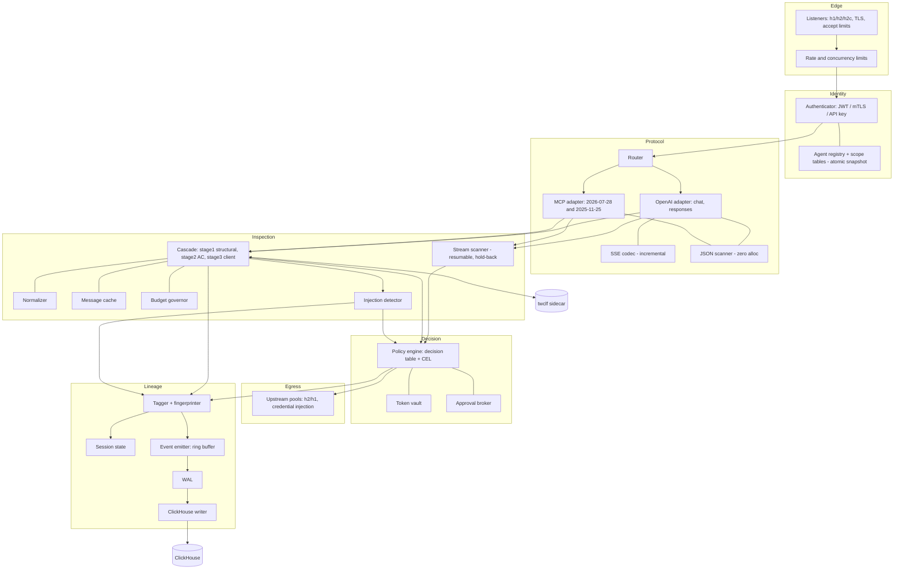
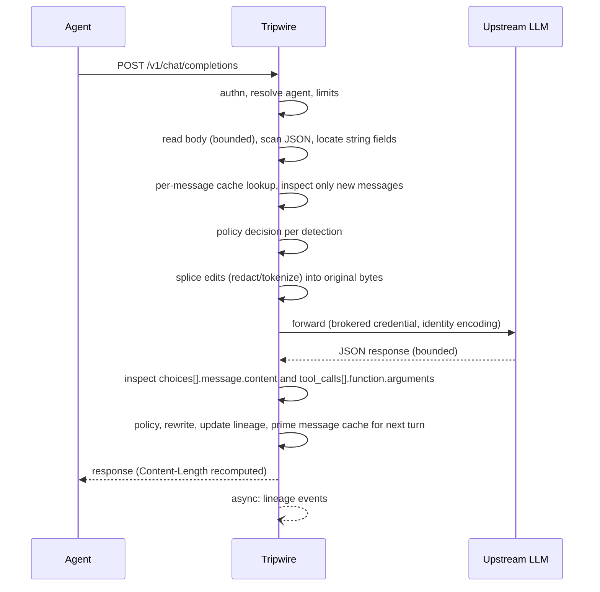
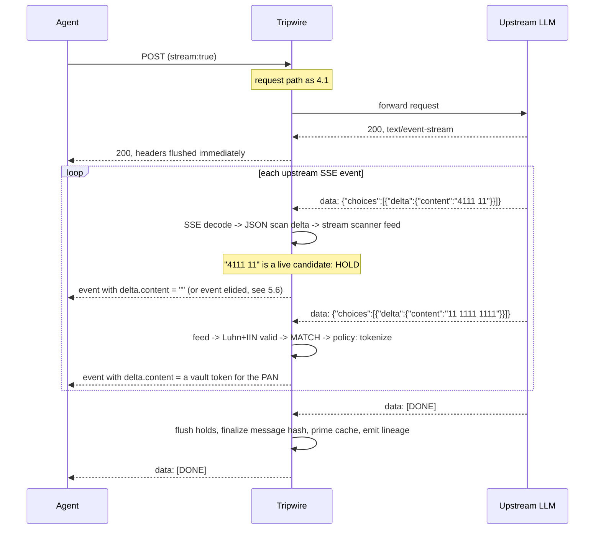

# Tripwire — Architecture

**Audience:** senior engineers. No concept is simplified; every choice carries its alternatives, its cost, and the condition under which we would revisit it.
**Companions:** [README.md](../README.md) (what and why) · [IMPLEMENTATION_PLAN.md](IMPLEMENTATION_PLAN.md) (how and in what order).
**Convention:** items tagged **[hypothesis]** are performance or accuracy numbers we believe but have not measured; Phase 0 and Phase 2 microbenchmarks exist to confirm or kill them. Nothing tagged `[hypothesis]` may appear in a README, resume or post until replaced by a measured value.

---

## Contents

0. [Baselines and assumptions](#0-baselines-and-assumptions)
1. [Requirements, SLOs and the latency budget](#1-requirements-slos-and-the-latency-budget)
2. [Threat model](#2-threat-model)
3. [System topology and component map](#3-system-topology-and-component-map)
4. [Request lifecycles](#4-request-lifecycles)
5. [The streaming inspection engine](#5-the-streaming-inspection-engine)
6. [Detection cascade](#6-detection-cascade)
7. [Policy engine](#7-policy-engine)
8. [Identity, authorization, credential brokering, tenancy](#8-identity-authorization-credential-brokering-tenancy)
9. [Injection defence](#9-injection-defence)
10. [Lineage](#10-lineage)
11. [Observability and self-measurement](#11-observability-and-self-measurement)
12. [Performance engineering](#12-performance-engineering)
13. [Failure model](#13-failure-model)
14. [Securing the gateway itself](#14-securing-the-gateway-itself)
15. [Decision log (tradeoffs and reasons)](#15-decision-log-tradeoffs-and-reasons)
16. [Risks and open questions](#16-risks-and-open-questions)

---

## 0. Baselines and assumptions

These were checked against current sources when this document was written (November 2026). Re-verify before Phase 1 begins; protocol baselines move.

| Area | Baseline | Consequence for design |
|---|---|---|
| **MCP** | Latest spec revision is **2026-07-28**, a *stateless* revision: protocol-level sessions and the `Mcp-Session-Id` header are removed, the `initialize` handshake is gone, SSE stream resumability (`Last-Event-ID` and event IDs) is removed, the GET stream endpoint is removed, and `Mcp-Method` / `Mcp-Name` headers are required on Streamable HTTP POSTs, mirroring body fields. The previous revision is **2025-11-25** (sessions, `initialize`, resumability). HTTP+SSE (2024-11-05) is deprecated. | Gateway implements **both** revisions behind one internal interface. In `2026-07-28`, headers are a *routing hint only*: the gateway **must verify header/body equality** (mismatch is a smuggling vector) and then act on the body. Server-side session state in the gateway is needed only for legacy servers. |
| **Go** | **Go 1.26.x** (released Feb 2026). Green Tea GC is the default; cgo call overhead reduced ≈ 30 %; goroutine-leak profile available as an experiment; experimental `simd/archsimd`. | Pin toolchain in `go.mod` and CI. Benchmark with `GOEXPERIMENT=nogreenteagc` once as a control (the opt-out is expected to be removed in Go 1.27, so decide with data, not habit). `simd/archsimd` is amd64-only and experimental: **evaluate, do not depend on it**. |
| **OpenAI wire formats** | **Chat Completions** SSE (`data: {chunk}\n\n`, terminated by `data: [DONE]`). **Responses API** streams *typed* semantic events (`response.created`, `response.output_text.delta`, `response.function_call_arguments.delta`, `response.mcp_call_arguments.delta`, `response.completed`, `error`, …), each with a `sequence_number`; some deltas carry a random `obfuscation` padding field. A WebSocket mode exists. | Chat Completions first (broadest compatibility, including vLLM and friends); Responses API second via the same delta-rewriter with a per-event-type schema table. Preserve `obfuscation` untouched. WebSocket mode: reject at the edge, documented non-goal. |
| **Hosted MCP in Responses** | A Responses request can declare tools of type `mcp` with a server URL; the **provider** then calls that MCP server directly. | This is an **egress bypass**: tool traffic never traverses the gateway. Policy: detect `tools[].type == "mcp"`, then block, or rewrite `server_url` to the gateway's MCP endpoint, per agent. |
| **Env** | Linux amd64 for the benchmark rig; arm64 supported for development (no assembly-only paths in the data path). | Pure-Go data path, `CGO_ENABLED=0`. |

---

## 1. Requirements, SLOs and the latency budget

### 1.1 Functional requirements

| ID | Requirement | Source |
|---|---|---|
| F1 | OpenAI-compatible endpoint with stream and non-stream | brief: "Proxy (Go)" |
| F2 | MCP endpoint (Streamable HTTP) | brief |
| F3 | SSE inspection **without buffering whole responses** | brief |
| F4 | Per-agent identity and tool scoping | brief |
| F5 | Detection cascade: validators → dictionary/entity → small ONNX classifier only when cheaper stages are unsure | brief |
| F6 | Lineage: tag at source (file, DB row, tool result), carry through prompts and tool calls, store graph in ClickHouse | brief |
| F7 | Policy: allow, redact, tokenize, require approval, block — per data class, agent, destination | brief |
| F8 | Injection defence: flag tool results carrying instructions aimed at the model; record which tool introduced them | brief |
| F9 | Inspect every prompt, tool argument and tool result in < 10 ms | brief |
| F10 | Sliding-window detection so a value split across stream chunks is caught | brief ("hard parts") |
| F11 | Every parser fuzzed (`go test -fuzz`) | brief ("hard parts", "proof plan") |
| F12 | Shadow/monitor modes to tune precision before enforcement | derived from "gateway that blocks too much gets switched off" |

### 1.2 Non-functional requirements

| ID | Requirement | Target |
|---|---|---|
| N1 | Added latency, request path | p99 < 10 ms hard; ≤ 6 ms design |
| N2 | Added latency, stream per event | p99 < 10 ms hard; ≤ 2 ms design, excluding declared hold-back |
| N3 | Throughput | 20 K req/s on W1 (README §6.3) |
| N4 | Lineage ingest | 1 M events/s into ClickHouse, sustained |
| N5 | Availability posture | Gateway failure must never silently degrade to "allow everything". Fail-open/closed is explicit and observable. |
| N6 | Memory | ≤ 32 KiB per idle stream **[hypothesis]**; hard per-stream cap on held bytes |
| N7 | Isolation | Tenant A's dictionaries, tags, tokens, cache entries never influence tenant B's decisions |
| N8 | Reproducibility | Every number regenerates from raw result files via one script |
| N9 | Operability | Hot reload of policy/dictionaries without dropping streams; versioned bundles; dry-run |
| N10 | Privacy of the store | Lineage store holds keyed fingerprints and redacted previews, never raw sensitive values |

### 1.3 Definitions that make "under 10 ms" falsifiable

"Inspects every prompt, tool argument and tool result in under 10 ms" is ambiguous in four ways. We resolve them up front and publish the resolutions.

1. **What is timed.** *Request path:* last request byte received → first byte of forwarded request sent upstream. *Stream path:* per event, upstream emit → client receive, minus a pass-through baseline. *MCP `tools/call` result:* upstream response complete (or per-event for streamed results) → forwarded.
2. **Which percentile.** p99, from HdrHistogram, recorded against *intended* send time (open loop, so coordinated omission cannot hide tail latency). We also publish p99.9 and max; the hard SLO is p99.
3. **Which payload sizes.** Inspection cost scales with **new bytes**, not total bytes (message cache, §6.8). The budget is stated for ≤ 16 KiB of new content per request and ≤ 1 KiB per stream event; larger inputs degrade *linearly and visibly*, and a per-request deadline governor (§6.6) bounds the worst case.
4. **What is excluded.** Network RTT, upstream model latency, and *declared hold-back* (policy-induced waiting for a candidate match to resolve). Hold-back is **reported as its own metric** so exclusion cannot be used to hide cost.

### 1.4 Latency budget (design allocation, **[hypothesis]**)

Request path, ≤ 16 KiB new content, p99:

| Step | Budget | Notes |
|---|---:|---|
| AuthN + agent registry lookup | 0.10 ms | JWT signature verify is cached per token `jti`/hash for its lifetime; Ed25519 verify is on the order of 50–150 µs when uncached **[hypothesis]** |
| Read + bound + scan JSON (zero-alloc scanner) | 0.50 ms | Single pass, offsets only |
| Message-cache lookup / insert | 0.05 ms | xxh3 of decoded text; sharded |
| Stage 1 + 2 detection on new bytes | 1.50 ms | ≈ 10 MB/s worst-case adversarial; ≈ 300 MB/s typical **[hypothesis]** |
| Stage 3 (only on uncertain band) | ≤ 3.00 ms | Hard deadline via budget governor; skipped if less than the stage-3 floor remains |
| Policy decision | 0.05 ms | Decision-table index lookup; CEL only for rules that need it |
| Rewrite (splice edits) | 0.30 ms | Vectored write over original slices where possible |
| Lineage hot-path (enqueue) | 0.10 ms | Lock-free ring; never blocks |
| Forward (header injection, pool checkout) | 0.20 ms | |
| **Sum** | **5.8 ms** | **4.2 ms headroom** under the 10 ms hard SLO |

Stream path, per event, p99: parse delta (≤ 40 µs) + stream-scanner feed (≤ 120 µs) + policy lookup (≤ 5 µs) + rewrite and write (≤ 100 µs) + scheduling jitter/GC (≤ 1.5 ms) ≈ **≤ 2 ms**.

---

## 2. Threat model

### 2.1 Assets

| Asset | Why it matters |
|---|---|
| Sensitive data in transit (prompts, tool args, tool results, model output) | The thing we exist to protect |
| Credentials the gateway holds (provider keys, MCP tokens, ClickHouse creds, token-vault keys) | Compromise defeats the purpose and escalates |
| Lineage store | Contains a map of where sensitive data lives and moved; a high-value target |
| Policy bundles and dictionaries | Tamper = silent bypass |
| Gateway availability | If it is in-path, DoS against it is DoS against all agents |
| Detector integrity | Poisoning/regression silently reduces recall |

### 2.2 Adversaries

| Actor | Capability | Typical goal |
|---|---|---|
| **A1 Malicious/compromised MCP server** | Controls tool results and tool descriptions | Inject instructions; exfiltrate via crafted results; cause parser bugs |
| **A2 Poisoned content** (web page, document, email retrieved by a tool) | Controls text the agent ingests | Indirect prompt injection; trigger a tool call that sends data out |
| **A3 Malicious or confused user** | Controls prompts | Obfuscated secrets to evade detection; policy probing; DoS |
| **A4 Compromised agent** | Valid credentials for one agent | Escalate tool scope; read other tenants' data; bypass via direct provider access |
| **A5 Curious co-tenant** | Valid tenant on shared deployment | Cross-tenant inference through cache timing, tags, tokens |
| **A6 Network attacker** | Between agent↔gateway or gateway↔upstream | Intercept/modify |
| **A7 Insider with admin rights** | Edits policy, reads lineage | Disable controls; harvest data |
| **A8 Honest-but-curious model provider** | Sees everything not redacted | Retention, training use — the reason the gateway exists |

### 2.3 Trust boundaries

```
 untrusted ────────────────┬──────────────── semi-trusted ───────────┬──── trusted
 tool results, retrieved   │ agents (authenticated, but may be        │ Tripwire process,
 docs, upstream responses, │ confused or compromised), operators'     │ its config/keys,
 model output              │ policy authors                           │ ClickHouse (ours)
```

Rule: **everything that arrives on a socket is parsed under limits, regardless of who sent it**, including "trusted" internal upstreams. The model's output is untrusted too: it may be the carrier of exfiltrated data.

### 2.4 Threats and mitigations

| # | Threat | Mitigation | Verified by |
|---|---|---|---|
| T1 | **Parser differential**: the gateway inspects interpretation X; the upstream acts on interpretation Y (duplicate JSON keys, different Unicode escape handling, comment/BOM tricks, header/body mismatch in MCP) | Forward **only the bytes the scanner produced or validated**. Reject duplicate keys in security-relevant objects, reject invalid UTF-8/lone surrogates, enforce `Mcp-Method`/`Mcp-Name` ≡ body, cap nesting. Differential fuzzing against `encoding/json` and a second implementation. | `FuzzJSONScanDiff`, `FuzzMCPHeaderBody` |
| T2 | **Obfuscated secret** (zero-width joiners, fullwidth digits, separators, homoglyphs, base64/URL/JSON-escaped, split across fields) | Normalization front-end in the scanner (skip/fold, not rewrite); optional bounded decode of base64/URL-encoded candidates (depth ≤ 2, size ≤ 4 KiB); eval set stratified by obfuscation | eval per-obfuscation recall |
| T3 | **Chunk-boundary evasion** (value split across SSE events/JSON fragments/tool-arg fragments) | Resumable detector state + hold-back (§5) | exhaustive split-position tests (§5.7) |
| T4 | **Algorithmic-complexity DoS** (regex backtracking, AC blowup, quadratic rescans of history, huge nesting) | No backtracking engines; all scanners O(n); message cache removes O(n²) history rescans; bounds on bytes/depth/matches per request | adversarial benchmarks in `FAILURES.md` |
| T5 | **Resource exhaustion** (slowloris, slow-read, 100 K idle streams, giant bodies, HTTP/2 floods) | Per-agent and global limits; header/body/read/write deadlines via `http.ResponseController`; stream byte caps; h2 stream limits; accept-rate limits | chaos suite |
| T6 | **Indirect prompt injection → tool abuse** | §9: detection + provenance + policy over *session state* (lethal-trifecta rule) + tool-scope + approvals | injection eval, scenario tests |
| T7 | **Exfil through the output channel** (markdown image/link with query string, long URL path, DNS-ish hostnames) | Response-side URL inspection: any URL whose query/path contains a session-tagged fingerprint or high-entropy blob → strip/block per policy | eval: exfil-URL set |
| T8 | **Tool description poisoning / rug pull** | Hash-pin tool descriptions and schemas at first sight per `(tenant, server)`; alert/deny on change; inspect descriptions for injection | MCP scenario tests |
| T9 | **Scope escalation** (calling unlisted tools; name tricks like Unicode lookalikes, case, trailing whitespace; `tools/call` for a name hidden from `tools/list`) | Scope check on **canonicalized exact name** after body/header equality check; deny-by-default | scope matrix tests |
| T10 | **Token passthrough / confused deputy** (agent's token forwarded to upstream) | Credential brokering; never forward the inbound `Authorization` upstream; per-upstream credentials only | header-leak test |
| T11 | **Cross-tenant leakage** (cache keys, dictionaries, vault tokens, tag IDs, log lines) | Tenant ID is part of every cache key, HMAC key derivation, vault key, ClickHouse row ordering key; no global caches of detections | tenancy tests, cache-timing review |
| T12 | **Lineage store as honeypot** | Store keyed fingerprints (HMAC per tenant), class labels, redacted previews (≤ 4 chars) only; field-level encryption for optional previews; row-level access by tenant | privacy test: grep raw values in store = 0 hits |
| T13 | **Policy/dictionary tampering** | Signed bundles (Ed25519), version pinned, last-good retained on verification failure | bundle tests |
| T14 | **Log leakage** (PII in debug logs and traces) | Structured logging with an allow-list of fields; payload bytes never logged; trace attributes are classes and counts | log-scan test in CI |
| T15 | **Replay of approvals** | Approval grant bound to `(agent, tool, args-hash, policy-version)`, one-time, TTL | approval tests |
| T16 | **Supply chain** | Minimal dependency set, `govulncheck`, pinned module hashes, SBOM, reproducible builds | CI |
| T17 | **Classifier abuse / model DoS** | Sidecar with deadline, queue cap, circuit breaker; bounded input length; separate cgroup | failure tests |
| T18 | **Header-borne data** (MCP `x-mcp-header` mirrored tool params, `Mcp-Name`, custom headers as an exfil channel) | Inspect mirrored header values with the same detectors as body fields; allow-list outbound headers | header inspection tests |

### 2.5 Explicitly out of scope

Compromised gateway host; side channels from the model provider; steganography in model output; semantic exfiltration (the model "describes" a secret in prose). We state these so nobody mistakes the gateway for more than it is.

---

## 3. System topology and component map

### 3.1 Logical component map



### 3.2 Deployment topologies

**Benchmark rig (3 VMs)** — the contract for published numbers:

| VM | Role | Sizing guidance | Isolation |
|---|---|---|---|
| A | `twload` + `twmock` (LLM + MCP mocks) | 16 vCPU. Load generator and mocks pinned to disjoint core sets so the mock never starves the generator. Shared clock for latency stamping. | `taskset`, performance governor |
| B | `tripwire` + `twclf` | 16 vCPU. Gateway gets cores 0–11, `twclf` gets 12–15 via cpuset; IRQ affinity for the NIC to gateway cores. | `GOMAXPROCS` set explicitly; THP off for the gateway; NUMA-aware if multi-socket |
| C | ClickHouse + Prometheus + Grafana + Tempo | 8–16 vCPU, NVMe | Separate from hot path so observability cannot steal gateway CPU |

**Production-shaped (documented, not required for the brief):** N stateless gateway replicas behind an L4 balancer with **session-affinity hashing** (consistent hash on session ID where available) so the per-session fingerprint state is local; state loss is tolerated (§10.5) so affinity is an optimization, not a correctness requirement. Classifier sidecar as a pod-local container on a Unix domain socket. ClickHouse as a separate service. Policy bundles distributed as signed artifacts, hot-reloaded.

### 3.3 Process model

Single statically linked Go binary, `CGO_ENABLED=0`, for the data path. **Why:** crash isolation (cgo segfaults kill the process), fuzzability, simple deploy, the ability to ship distroless. The ONNX runtime lives in a separate process (`twclf`) (ADR-07).

Concurrency model: one goroutine per accepted request (net/http), one additional goroutine per *streaming* response for the upstream read loop (§5.2). No goroutine per event. Shared mutable state is limited to: sharded caches, the lineage ring, the registry snapshot (`atomic.Pointer`), and the budget governor's EWMAs.

---

## 4. Request lifecycles

### 4.1 Chat Completions, non-streaming



Details that matter:

- **Request body is buffered** (bounded; default 8 MiB, configurable per agent). Unlike responses, requests must be decided before they are forwarded, because a `block` or `redact` has to precede egress. Streaming the request upstream while scanning would make `block` impossible. Cost accepted: memory = body size; mitigated by caps and by the message cache so rescans are not repeated.
- **Which strings are inspected.** Known fields get *role-aware* handling: `messages[].content` (string or array of parts; only `text` parts), `messages[].name`, `messages[].tool_calls[].function.{name,arguments}`, `tools[].function.{name,description,parameters}`, `response_format.json_schema`, `metadata`, `user`. **Unknown fields**: every string value is scanned with a cheaper "generic string" profile. Providers add fields constantly; skipping unknown strings is a bypass.
- **`Accept-Encoding: identity` upstream.** We need plaintext to inspect. Alternatives: streaming decompression + recompression (CPU cost, and gzip state makes hold-back awkward) or inspecting compressed bytes (impossible). Cost accepted: more bandwidth on the upstream leg, which is typically intra-region and small relative to the token stream.
- **Inbound compressed request bodies** are decompressed with a hard ratio and size cap (bomb protection) or rejected.
- **Content-Length recomputation** for non-stream responses after rewrite; chunked otherwise.

### 4.2 Chat Completions, streaming



- **Headers are flushed on first upstream byte**, before any inspection result exists. Status code is therefore `200` for the life of the stream. A mid-stream `block` cannot change the status; see §5.6 for the termination protocol.
- **Time to first byte (TTFB)** is dominated by request-path inspection plus upstream TTFB; the stream path adds nothing to TTFB beyond header flush.

### 4.3 Responses API

Same pipeline with a **per-event-type schema table** instead of `choices[].delta`:

| Event type | Inspected field(s) | Notes |
|---|---|---|
| `response.output_text.delta` | `delta` | text; `item_id`, `output_index`, `content_index` select the scanner instance |
| `response.refusal.delta` | `delta` | inspect (a "refusal" can still leak) |
| `response.reasoning_summary_text.delta`, `response.reasoning_text.delta` | `delta` | policy per agent: inspect-and-record by default; reasoning text is often not shown to users |
| `response.function_call_arguments.delta` | `delta` | JSON-in-string fragments, §5.5 |
| `response.mcp_call_arguments.delta` | `delta` | hosted-MCP bypass indicator; also inspect |
| `response.output_text.annotation.added` | URL fields | exfil-URL check |
| `response.completed` / `response.output_item.done` | final objects | **authoritative final text**: re-inspect to catch anything the deltas path missed; the final event contains full items |
| anything unknown | all strings, generic profile | fail-safe |

`sequence_number` is preserved. **If hold-back elides an event, sequence numbers are not renumbered** (clients should tolerate gaps; if a client library does not, `coalesce` mode in §5.6 sends an empty-delta event instead of eliding).

### 4.4 MCP

Two revisions, one internal interface (`mcp.Conn`), selected by the `MCP-Protocol-Version` header on each request (and by the presence of `initialize` for legacy).

**`2026-07-28` (stateless).** Each POST is self-describing. Required headers `Mcp-Method` and `Mcp-Name` mirror the body. The gateway:

1. Parses the JSON-RPC body (small, bounded), **verifies header ≡ body** (method and name), rejects on mismatch with a JSON-RPC error and an audit event.
2. Resolves scope using the canonical tool name.
3. Inspects `params` strings (tool arguments, resource URIs, prompt arguments) and any **header-mirrored tool parameters** (`x-mcp-header` custom headers).
4. Forwards with the per-server brokered credential (never the inbound token).
5. Response is either `application/json` or `text/event-stream`. A JSON response is inspected as a whole; an SSE response is inspected per event with the same stream scanner as chat. The final JSON-RPC response terminates the stream. Dropped stream = lost request (no resumability): the gateway **does not** invent resumption.

**`2025-11-25` (sessions).** `initialize` establishes `Mcp-Session-Id`; the gateway keeps a session table `(gw-session ↔ upstream-session, negotiated version, capabilities, pinned tool hashes)` with TTL and bounds, and forwards `Last-Event-ID` resumption transparently (it never re-orders or fabricates events; if a rewritten event was already held, the held bytes are discarded on reconnect and re-derived — see §13 F-24).

**Methods and handling**

| Method | Inspect | Enforce |
|---|---|---|
| `tools/list` (response) | descriptions, schemas for injection; hash for pinning | **Filter** to the agent's scope; pin or alert on change |
| `tools/call` (request) | `arguments` (deep string walk) | scope check; destination policy; approval; tokenization→detokenize at cleared tools |
| `tools/call` (response) | `content[].text`, `structuredContent` (strings), resource links | tag at source (lineage), injection scan, redaction per policy |
| `resources/read` (response) | contents | tag at source: **this is the "file / DB row" lineage origin** |
| `prompts/get` (response) | messages | injection scan |
| server→client requests (legacy `sampling`, `elicitation`) | message text | treated as a model call / user prompt respectively |

`tools/call` arguments are *complete* at the MCP layer (unlike the model-emitted partial JSON on the LLM path), so **structured destination constraints** (e.g., recipient domain allow-list) are enforced here, not on the LLM response path (§5.5).

### 4.5 The two observation points and why lineage needs both

For OpenAI-style agents, the model emits a tool call, the **agent** executes it (possibly via MCP through the gateway), and the agent sends the result back in the *next prompt*. So the same value is observed twice:

1. At the **MCP response** (authoritative source: server, tool, call ID, resource URI).
2. At the **LLM request** (sink: this model, in this message, role `tool`, `tool_call_id`).

Lineage is the join of these via value fingerprints and `tool_call_id` (§10). If the agent does not route MCP through the gateway, the gateway still sees (2), and the source is attributed from `tool_call_id → assistant.tool_calls[].function.name` found in the same request's history, with lower source fidelity (`source_kind = inferred_tool`).

---

## 5. The streaming inspection engine

This is the technical core. Every other component is conventional by comparison.

### 5.1 Problem statement

Given an upstream byte stream of SSE events, each carrying a JSON object with a fragment of text, produce a downstream SSE stream such that:

1. **No byte that is part of a detected sensitive span is ever emitted** in clear (for classes in an *enforced-strict* tier).
2. **Detection is independent of how the upstream chose to chunk the text** (event boundaries, JSON string escape boundaries, UTF-8 multibyte boundaries, TCP segment boundaries).
3. **Memory is O(1) per stream** (bounded hold-back, bounded scanner state).
4. **Latency added per event is bounded** and *held bytes* are bounded in both size and time.
5. **Non-text events** (role, usage, finish_reason, tool-call metadata) pass through with minimal handling and **never reorder** relative to text events of the same choice.

### 5.2 Pipeline and goroutines

```
upstream conn ──► bufio.Reader ──► SSE decoder ──► event router ──┬─► JSON delta scanner ─► text fragments
                                                                    │                          │
                                                                    │                    stream scanner (per choice/item)
                                                                    │                          │ safe bytes + detections
                                                                    ▼                          ▼
                                                           passthrough events      delta rewriter ─► SSE encoder ─► ResponseWriter + Flush
```

**Single read-inspect-write loop per stream** (one extra goroutine to pump the upstream body if the transport needs one; otherwise the handler goroutine is the loop). Alternatives considered:

| Option | Pros | Cons | Verdict |
|---|---|---|---|
| **A. One loop: read → inspect → write → flush** | Lowest latency, zero channel hops, natural backpressure: slow client ⇒ blocked `Write` ⇒ we stop reading upstream | Slow client head-of-line blocks reading; upstream may time out on its side | **Chosen**, with write deadlines and an upstream-side idle budget |
| B. Reader goroutine → channel → inspector/writer | Decouples read from write | Channel hop per event ≈ 100–200 ns + scheduler wakeups; unbounded buffering risk; extra goroutine per stream; worse tail latency at 26 K streams | Rejected for the default; reconsidered if profiling shows read stalls matter |
| C. Worker pool fed by events | Bounded CPU concurrency | Reorders unless sharded by stream; cross-core cache misses; added latency from queueing | Rejected |

`http.ResponseController` sets a **per-write deadline** (`SetWriteDeadline`) before each flush so a stalled client cannot pin a goroutine and its held buffers indefinitely (default 10 s, configurable). Total stream wall-clock cap and idle-gap cap are enforced independently.

### 5.3 Components

**SSE decoder.** Incremental, allocation-free after warm-up, over a reused `[]byte` window. Handles `\n`, `\r`, `\r\n` line endings (all valid), a leading BOM, comment lines (`:`), `event:`, `data:` (multi-line `data` joined with `\n`), `id:`, `retry:`, and events that span TCP reads. Provides *spans* into the buffer, not copies, plus a **verbatim-forward** mode for events that are not rewritten (we forward the original bytes, preserving upstream formatting exactly).
Hard limits: max line, max event size (default 1 MiB; an event over the limit ⇒ terminate stream with a protocol error), max events per second per stream (anti-abuse).
Rewrites **never** emit a replacement that could create a bogus event boundary: replacements are validated to contain no `\r`/`\n` outside JSON string escaping, and are emitted already JSON-escaped.

**JSON delta scanner.** A hand-written, single-pass tokenizer over bytes that:

- Locates only the paths we care about (`choices[*].delta.content`, `choices[*].delta.tool_calls[*].function.arguments`, `choices[*].delta.refusal`, plus the Responses event table) without building a DOM.
- Produces *byte spans of string values* and a **decoder state for JSON string escapes**, yielding decoded text as it goes (`\n`, `\"`, `\\`, `\uXXXX` including surrogate pairs that may be split across events — the decoder carries pending high-surrogate state).
- Records enough position information to **re-encode** the (possibly shortened) delta and splice it back into the original event bytes.
- Rejects duplicate keys at the levels it understands, depth > 64, strings > limit, invalid UTF-8 (policy: reject or `U+FFFD`-replace with an audit event; default reject).
- Falls back to a full, strict parse (`encoding/json` or `json/v2` if stable) only for **non-hot** event shapes. The fast path is differential-fuzzed against the fallback.

Why not `encoding/json`: it allocates per value and reflection-decodes; at ≈ 1.3 M events/s the allocation rate alone would dominate GC (§12). Why not an existing fast parser (`jsonparser`, `simdjson-go`, `sonic`): some are unsafe-heavy, some amd64-only or JIT-based, none give us resumable *string-escape* state or exact splice offsets; and a security gateway wants a parser it can fuzz and fully reason about (ADR-04).

**Event router.** Maps event shapes to scanner instances: `(choice_index)` for chat; `(item_id, output_index, content_index)` for Responses; `(tool_call_index)` for tool-call arguments. Each instance owns a `StreamScanner`.

**Stream scanner** — §5.4.

**Delta rewriter.** Given `(original event bytes, string-value span, new decoded text)`, produces output bytes by splicing; emits via `net.Buffers`/`writev` when the event is large, or into a small reused buffer when small. Never re-serializes the whole JSON object (preserves key order, whitespace and unknown fields — useful both for fidelity and so that upstream-specific fields survive).

### 5.4 Hold-back tiers (the hard part)

A stream scanner is a set of detector state machines advanced byte by byte over *decoded* text, plus a **hold-back buffer**. Per `feed(fragment)` it returns `(emit []byte, detections []Detection)`:

- `emit` is the prefix of (held bytes ∥ fragment) that **cannot be part of any still-possible match** for a class in the strict tiers.
- Bytes after that remain **held**; they are released on the next `feed` once the candidate resolves, or on `flush()` (finish, error, idle timer).

What counts as "could still be part of a match" differs by detector, which is why the hold-back is *tiered*. The goal is to hold the **fewest bytes, for the shortest time, only where leaking is unacceptable**.

| Tier | Classes | What triggers hold | Max held | Typical hold time | Enforcement |
|---|---|---|---|---|---|
| **T1 Structural-candidate** | `PCI.PAN`, `FIN.IBAN`, `FIN.ROUTING`, `GOV.*` numeric IDs, `SECRET.*` with fixed prefixes/format (AWS, GitHub, Slack, Stripe, Google, JWT, PEM), URL-embedded credentials | A digit-run (allowing single separators) that is a viable prefix of a numeric pattern; or a byte sequence that is a prefix of a known secret literal | ≈ 32 B (digits+separators), PEM header ≤ 64 B; PEM *body* is handled as "in-block" state (below) | one upstream inter-event gap, only while the candidate is live | **Strict**: redact/tokenize/block before any byte leaves |
| **T2 Session-literal** | Any value already tagged in this session (emails, names, IDs, record numbers that appeared in context) and tenant dictionary terms | Aho–Corasick state ≠ root *within the session automaton* | length of the longest known value prefix matched so far (bounded, default 128 B) | microseconds–one gap, and **only when the model is echoing a known value** | **Strict**, precise: this is exactly the exfil-by-echo case |
| **T3 Fuzzy generic** | novel emails, phones, names, addresses not previously seen | Only after an anchor appears (`@`, `+`/country code, title/context cue) | tail of the current word-run when `strict_tail_hold` is on, otherwise 0 | 0 (default) or one inter-event gap | **Best-effort**: anchor-triggered redaction of the remainder; the *prefix already emitted* (e.g., email local part before `@`) is recorded as a **stream-leak** event. Optional `strict_tail_hold` buys full coverage for one-token latency |
| **T4 Classifier-based** | Stage-3 entity/secret/injection decisions | None in the stream path | 0 | n/a | **Detect-and-record in stream; enforce in `buffered` mode** (sentence/paragraph window) |

**Why tiering instead of one policy.** Holding back every word to catch a novel email would add one token of latency to *all* text — a policy-induced cost on 100 % of traffic to protect a class whose novel (not-in-context) instances are low-risk. Holding back a digit-run costs nothing on prose and protects the highest-severity structural classes. Holding back on a session-literal match costs nothing unless the model is actually reproducing something sensitive from context. The tier table is **per-class configurable**; the defaults reflect risk and cost.

**State machines (T1).** One merged scanner over the byte-class table rather than N independent passes:

1. A 256-entry class table maps each decoded byte to `{digit, alpha, sep(space,-,.), at, other, prefix-start}`.
2. A **run tracker** collects digit-runs permitting single `sep` between groups, up to the maximum pattern length. On run end (any non-digit/non-sep byte), candidate validators run: Luhn + IIN range (13–19 digits), IBAN (letters+digits, length by country, mod-97), ABA (9 digits, 3-7-1 weights), Verhoeff (12 digits, Aadhaar), SSN structural rules (3-2-4 with exclusions), phone shape (E.164/national) feeding T3.
3. **Prefix literals** (`AKIA`, `ASIA`, `ghp_`, `github_pat_`, `xox[abp]-`, `sk_live_`, `sk-`, `AIza`, `eyJ`, `-----BEGIN `) are an Aho–Corasick automaton with a *serializable state integer*. A hit transitions to a **format-specific tail matcher** (fixed length, charset, optional checksum).
4. **In-block state.** For PEM private keys, hit `-----BEGIN … PRIVATE KEY-----` ⇒ enter `in_block` state: **suppress all bytes until the matching `END` marker or a length cap**, emitting one replacement token. This prevents a 2 KiB key body from being scanned/held in pieces.
5. **Context keywords** (`cvv`, `cvc`, `expiry`, `password`, `secret`, `token`, `api_key`, `ssn`, `aadhaar`, …) are tracked via a small ring of the last 64 emitted bytes plus a keyword automaton; they *boost confidence* of adjacent candidates and make otherwise-weak formats (e.g., 3–4 digit CVV) detectable.

**Hold-back release rules** (precisely, because this is where bugs live):

- A byte is **releasable** iff no live candidate in a strict tier includes it. Candidates are tracked as `(start_offset, class_mask)`; `emit_upto = min(start_offset of live strict candidates, fragment_end)`.
- On **candidate failure** (e.g., digit-run ends but Luhn fails): all held bytes of that candidate are released *unchanged* with the next emit.
- On **candidate success**: the span is replaced by the action output; earlier bytes (before the span) were already releasable; bytes after the span restart scanning.
- **Overlap**: two live candidates overlapping (a 16-digit PAN inside a 19-digit run): hold until the *longest* viable one resolves; resolution picks by (validator confidence, length, class priority).
- **Flush** (finish, idle-timeout, upstream error, client cancel): release all held bytes through a *final* evaluation (a trailing digit-run is validated on flush, not discarded).
- **Max-hold timer**: a held candidate older than `max_hold` (default 250 ms, > any normal inter-token gap) is force-resolved by evaluating it as-is. This bounds the latency penalty when the upstream stalls mid-candidate, and bounds memory.

### 5.5 Tool-call argument streams

On the LLM path the model emits `tool_calls[i].function.arguments` as **fragments of a JSON document encoded as a JSON string** (double encoding: fragments contain `\"`, `\\n`, etc.). The scanner therefore has **two nested decoders**: outer JSON-string-escape decode (as above) then an *inner* lightweight JSON-text view used for (a) detection (we scan the decoded inner text as text) and (b) *key-aware* confidence (value under a key named `password`, `ssn`, `card_number`). Structural validation of the inner JSON is **not attempted** until arguments complete (arguments may be malformed mid-stream by design).

Consequences:

- **Detection and redaction apply streaming** (T1/T2 tiers), exactly like text.
- **Argument-shape constraints** (recipient allow-list, path prefix, SQL read-only) **cannot be enforced on the LLM path** because the arguments are incomplete until `finish_reason == "tool_calls"`, and because on this path the gateway is *not* executing the call. They are enforced **at the MCP layer** where arguments are complete and the gateway is on the execution path (§4.4). For agents that execute tools outside the gateway, the LLM-path check is "detect + record + optionally truncate the stream and emit `finish_reason: content_filter`".
- **Tool-name scoping on the LLM path**: the function `name` arrives first (usually fully in one event); if it is out of the agent's scope, we can terminate early. Names split across events are accumulated; decision happens when the name resolves or the first argument fragment arrives, whichever is first.

### 5.6 Rewrite, elide, coalesce, terminate

Given a hold, the downstream event for the fragment that triggered it must still be *something*. Three modes (per route, default `empty-delta`):

| Mode | What the client sees | Pros | Cons |
|---|---|---|---|
| **`empty-delta`** (default) | Event preserved with `delta.content = ""`; held text appears in a later event | Event count and `sequence_number`s preserved; maximal client compatibility; lets non-text fields (e.g., `logprobs`, `usage`) ride along | A few extra tiny events |
| `elide` | Event dropped entirely when it carries only held text | Fewer events | Breaks clients that assume monotone `sequence_number` or one event per `choices` index per step; loses piggybacked fields |
| `coalesce` | Held text merged into the *next* event for the same choice; trailing empty event kept | Fewest events | Changes event/token alignment (matters if clients compute per-token timing or use logprobs aligned to deltas) |

**Block mid-stream.** Status is already 200. Protocol: stop reading upstream (close upstream body to cancel generation and stop token spend), emit a final event for each open choice with `finish_reason: "content_filter"`, then an OpenAI-style `error` event object for clients that parse it, then `data: [DONE]` (Chat) or `response.failed`/`error` (Responses), and close. **Held bytes are discarded**, never flushed after a block. An audit event with the matched class and policy ID is emitted. This is the one place where the gateway intentionally violates "preserve client-visible semantics"; it must be documented in the API notes.

**`finish_reason` / `[DONE]` / `response.completed` ordering.** Terminal events trigger `flush()` first, so held-then-released text is emitted *before* the terminal event. A test asserts that for every split of every golden string, concatenated deltas equal the expected output and the terminal event is last.

### 5.7 Correctness testing strategy for streaming (summary; details in the plan)

1. **Exhaustive split testing.** For each golden string with a known sensitive span: every 2-way partition at every byte offset (inside multi-byte UTF-8 and inside `\uXXXX` escapes too), every 3-way partition on a sampled grid, and random k-way (k ≤ 20) partitions with a seeded RNG. The assertion is *invariant under chunking*: output text and detection set are identical for all partitions.
2. **Property tests** (`gopter`/`rapid`): chunk-invariance, idempotence (scanning already-redacted output yields no new detections for the same class), monotonicity (adding irrelevant text around a span cannot remove the detection).
3. **Differential tests**: stream scanner vs. a slow reference scanner that sees the entire text at once.
4. **Fuzzing**: `FuzzSSEDecoder`, `FuzzJSONDelta`, `FuzzStreamScanner` (arbitrary partitioning of arbitrary text), `FuzzRewriter` (rewritten JSON remains valid and parses to the expected structure).
5. **Ground-truth e2e**: `twmock` injects sensitive values at recorded offsets with random chunking; after the run, `tweval` checks no clear-text byte of any injected span appears at the client.

---
## 6. Detection cascade

### 6.1 Principles

1. **Cheapest-sufficient-first.** Each stage emits `(class, span, confidence, evidence)`. A later stage runs only if an earlier stage left a span in the **uncertain band** or a high-risk region unresolved, *and* the budget governor says there is time.
2. **Precision is a first-class budget, not a by-product.** Every detector ships with a hard-negative corpus and a per-class false-positive-per-1,000-requests target. A detector that cannot meet its FP target runs in `monitor` until it can.
3. **Detectors are pure functions of text.** Same bytes ⇒ same detections. This is what makes the message cache (§6.8) correct. Context (agent, destination, session) enters only at the policy layer, with one explicit exception: the session-literal automaton (T2), which is an *input* to scanning and is versioned into the cache key by hashing the session tag-set generation.
4. **Everything is resumable.** Detector state is a small value type that can be saved at an event boundary and resumed (§5).

### 6.2 Data-class taxonomy (initial)

Hierarchical dotted names; policy globs (`SECRET.*`) address subtrees. Each class declares: validator(s), default confidence floor, streaming tier (§5.4), `linkability` (`tenant`|`session`, §10.2), default policy severity.

| Class | Examples | Stage-1 mechanism | Tier |
|---|---|---|---|
| `PCI.PAN` | 13–19 digit cards | digit-run tracker + Luhn + IIN range table; separators ` -` and `.` | T1 |
| `PCI.CVV`, `PCI.EXPIRY` | 3–4 digits, `MM/YY` | **context-only**: fires only within a keyword window of `cvv`/`cvc`/`expiry`/`exp` or adjacent to a PAN | T1 (when context present) |
| `FIN.IBAN` | `GB82 WEST 1234 5698 7654 32` | country prefix + length table + mod-97 | T1 |
| `FIN.US_ROUTING` | ABA | 9 digits + 3-7-1 checksum, context keyword boost | T1 |
| `GOV.US_SSN` | `123-45-6789` | structure + exclusions (area 000/666/9xx, group 00, serial 0000) + context boost | T1 |
| `GOV.IN_AADHAAR` | 12 digits | Verhoeff, first digit 2–9 | T1 |
| `GOV.IN_PAN` | `ABCDE1234F` | `[A-Z]{5}\d{4}[A-Z]` with valid 4th-letter entity code, context boost | T1 |
| `GOV.*` (other) | national IDs | table-driven (length, charset, checksum) | T1 |
| `SECRET.AWS_ACCESS_KEY` | `AKIA…`, `ASIA…` | prefix literal + 16 base32-ish chars | T1 |
| `SECRET.AWS_SECRET` | 40 base64-ish chars | **context + entropy** (keyword window `aws_secret`, `secret_access_key`) | T1 (when context present) |
| `SECRET.GITHUB_TOKEN` | `ghp_…`, `github_pat_…` | prefix + length + charset; **embedded checksum where the format defines one (verify against current GitHub docs before relying on it)** | T1 |
| `SECRET.SLACK`, `.STRIPE`, `.GOOGLE_API`, `.OPENAI`, `.ANTHROPIC`, `.NPM`, `.PYPI`, `.TWILIO`, `.SENDGRID` | vendor key formats | prefix + shape table, loaded from a **data file** so formats update without code changes | T1 |
| `SECRET.JWT` | `eyJ…` ×3 | base64url structure + decode header JSON and check `alg` | T1 |
| `SECRET.PRIVATE_KEY` | PEM blocks | BEGIN-marker literal → `in_block` suppression | T1 |
| `SECRET.URL_CRED` | `postgres://u:p@host` | scheme + `userinfo` with `:` | T1 |
| `SECRET.GENERIC` | `password=…`, high-entropy near keywords | keyword window + Shannon/entropy+charset test | T1 (when context present), else stage 3 |
| `PII.CONTACT.EMAIL` | `a@b.tld` | `@` anchor, expand left/right over RFC-5322-ish local/domain sets, TLD check | T2 (known) / T3 (novel) |
| `PII.CONTACT.PHONE` | E.164 / national | digit-run + country/length rules + context boost | T3 |
| `PII.NAME`, `PII.ADDRESS`, `PII.ORG` | free text | stage 2 gazetteer + stage 3 NER | T2 (known) / T4 |
| `CUSTOM.DICT.*` | tenant terms (codenames, customer names, internal hosts) | stage 2 Aho–Corasick | T2 |
| `LABEL.*` | classification markings (`CONFIDENTIAL`, `INTERNAL USE ONLY`, custom) | stage 1 literal/phrase table | T1 (label ⇒ the *whole source* inherits the class; see §10.2) |
| `INJECTION.*` | see §9 | separate detector family | n/a |

### 6.3 Stage 1 — structural detectors and validators

**Why hand-written state machines instead of regexes.**

- Go's `regexp` is RE2-style: linear-time and safe, but (a) **not resumable** — you cannot save a match state at an event boundary and continue; (b) slow relative to purpose-built byte scanners on the common case; (c) multi-pattern alternation scales poorly.
- Backtracking engines (PCRE-class, via cgo) are rejected outright: ReDoS is an attack surface and cgo breaks our static-binary rule.
- Hyperscan-class engines (`go-hyperscan`, cgo) offer streaming mode with saved state and excellent throughput. Rejected for the data path: cgo, amd64-centric, build and licence friction, and we gain little because our patterns are mostly *structural* (digit runs + checksum), where the validator, not the regex, is the cost. Revisit only if the pattern set grows into the hundreds of free-form regexes (ADR-02).
- Validators (Luhn, Verhoeff, mod-97, ABA) are code, not regex features, so a regex front-end would still need a code back-end.

**Structure.**

```go
// Sketch of the contract, not final API.
type Scanner interface {
    // Feed advances state over decoded text; returns spans finalized so far and
    // the offset below which input can no longer be part of an open candidate.
    Feed(p []byte, final bool) (done []Span, safeUpTo int)
    Save() State            // small value type (<= 256 B), copyable
    Restore(State)
}
```

- A **front-end byte-class pass** uses a 256-entry table and `bytes.IndexByte`-style accelerated search to skip long runs of "uninteresting" bytes (most prose) in one stride; the state machine engages only at anchors (digit, `@`, known-prefix first byte, keyword first byte).
- **Multi-literal matching** (secret prefixes, context keywords, label phrases) uses one **Aho–Corasick automaton in dense-table form** for small sets (state × byte-class, uint16/32 transitions) and a double-array trie for large dictionaries (stage 2). We write our own because the automaton's state must be an `int` we can save/restore mid-stream; most off-the-shelf Go AC libraries do not expose that.
- **Normalization is folded into the byte walk** (see §6.7): zero-width and soft-hyphen are *skipped but offset-tracked*, fullwidth/Arabic-Indic digits are *folded* to ASCII digits for the run tracker; offsets always refer to original bytes so rewrites splice correctly.
- **Validators are run only on candidates** (≈ 0.1–1 % of positions in typical text), so their cost is amortized.

**Throughput expectations [hypothesis]:** ≥ 300 MB/s per core on benign ASCII prose; ≥ 10 MB/s per core on adversarial digit-dense input (all-digit text with separators, designed to maximize candidate rate). These two numbers bound request-path stage-1/2 cost: 16 KiB ≈ 0.05 ms typical, ≈ 1.6 ms worst-case, which is why the budget allots 1.5 ms. If measured values are worse than half of these, Phase 2's first task is a profile-guided rewrite of the front-end before any new detector is added.

### 6.4 Stage 2 — dictionaries and entities

- **Tenant dictionaries**: exact phrases (customer names, project codenames, internal hostnames, employee names, account numbers formats). Compiled to an AC automaton per tenant (double-array for > 10 K terms), **built off the hot path**, published via atomic pointer swap, memory-capped per tenant, with case-folding and word-boundary options per term. Dictionary **updates never block streams**: in-flight streams keep the automaton they started with.
- **Session-literal automaton** (T2): built from values already tagged in the session. Small-set optimization: ≤ 32 literals use a first-byte bitmap + trie (no AC build), larger sets use AC, rebuilt copy-on-write when the set changes (microseconds for tens of values).
- **Gazetteer + context heuristics for names/addresses**: first-name / surname lists (licence-checked public sources), title cues (`Mr.`, `Dr.`, `Ms.`), capitalized-token sequences adjacent to cues like `Dear`, `Sincerely`, `Name:`, `Customer:`; address cues (street-suffix gazetteer + number + postcode shape per locale). These produce **low-confidence spans by design**: they exist to nominate candidates for stage 3, and to give high precision *only* when context is strong.
- **Why not a Bloom filter / FST / cuckoo set** for dictionaries (ADR-24): they answer membership, not *streaming prefix state*; we need the latter for hold-back. A Bloom filter is still used as a **negative pre-filter on whole tokens** for very large dictionaries (≥ 1 M terms) to avoid AC traversal on tokens that cannot match.

### 6.5 Stage 3 — small ONNX classifier

**Tasks**

| Task | Input | Output | Why a model |
|---|---|---|---|
| **S3-NER** | ≤ 64-token window around a nominated span | `PERSON/ADDRESS/ORG/OTHER` + probability | Names/addresses have no checksum; context decides |
| **S3-SECRET** | token + ±N chars of context | secret-vs-benign probability | High-entropy strings are ambiguous (hashes, UUIDs, base64 images, IDs vs credentials) |
| **S3-INJECT** | ≤ 256-token chunk of untrusted content | injection probability | Heuristics miss paraphrase and obfuscation (§9) |

**Process boundary (ADR-07).** The classifier runs in **`twclf`**, a separate process, reached over a **Unix domain socket** with a compact length-prefixed binary protocol: `{req_id, deadline_unix_ns, task, n_spans, spans[]{text bytes, flags}}` → `{req_id, status, results[]{label, prob}}`.

| Option | Pros | Cons | Verdict |
|---|---|---|---|
| In-process via cgo ONNX Runtime | No IPC; simplest call path | A segfault or hang in ORT takes down the gateway; ORT thread pools compete with the Go scheduler (CPU contention, cache pollution, latency jitter on the hot path); cgo kills static builds and complicates fuzzing/CI/cross-compile; goroutines blocked in cgo hold an OS thread each | Rejected |
| **Out-of-process sidecar over UDS** | Crash/hang isolation; **CPU isolation by cpuset** (ORT threads cannot steal gateway cores); gateway stays `CGO_ENABLED=0`; independently scalable and restartable; can host a GPU model later | ≈ 30–60 µs IPC round-trip **[hypothesis]**; serialization; one more process to operate | **Chosen** |
| Pure-Go inference (e.g. Go-native ONNX interpreters) | No cgo, no sidecar | Expected to be substantially slower on transformer models (**to be measured, not assumed**); operator coverage gaps | Rejected for now; acceptable only for tiny models |
| Remote inference service (gRPC over network) | Elastic | Network RTT + jitter eats the 3 ms stage budget; new failure domain | Rejected |

**Latency plan [hypothesis]:** int8-quantized small models, sequence length ≤ 64 (NER, secret) or 256 (injection, async-eligible), ORT intra-op threads = 2–4 pinned, dynamic micro-batching (collect up to 16 spans or 300 µs, whichever first; the batch window is **taken from the request's remaining budget**, never added on top). Target: stage-3 call p99 ≤ 3 ms for ≤ 8 spans × 64 tokens. **Decision rule if the target is unreachable** on the rig: replace the transformer NER with a char-CNN/BiLSTM-CRF-class model (smaller, lower recall on rare names) and say so in `BENCHMARKS.md`; do not hide the trade.

**Candidate nomination (this is what makes the cascade cheap).** Stage 3 never scans whole documents. It receives **at most K = 8 spans per request** (K′ = 2 per stream event window), ranked by `risk_weight × uncertainty` (uncertainty = `1 − |2c − 1|` on the calibrated confidence), from:

- stage-1/2 spans with confidence in the uncertain band;
- capitalized-token sequences near cue words (names/addresses);
- high-entropy tokens adjacent to key-like names (`key`, `token`, `secret`, `pwd`, `auth`);
- injection-nominated chunks (§9) when stage-1 heuristics are inconclusive.

**Streaming and stage 3.** Stage 3 cannot be on the per-token path. On streams it runs at **event-batch boundaries** (every ≈ 128–256 B of decoded text or at sentence end) and results are **detect-and-record** for the T4 tier: they feed lineage and alerts but cannot un-send bytes. For routes that need enforcement on stage-3 classes there is `buffered` mode: hold the response at sentence/paragraph granularity (declared hold-back, reported separately). This is the honest cost of classifier-grade detection on a stream, and it is a policy choice per route, not a hidden default.

**Model lifecycle.** Models are versioned artifacts with a **model card** (training data, eval metrics per class, license, quantization recipe, known blind spots). Loading a model into `twclf` requires the eval gate to have passed in CI for that exact artifact hash. `twclf` is restartable without dropping gateway streams (the gateway treats an unavailable sidecar as a stage-3 timeout).

### 6.6 Confidence, the uncertain band, and the budget governor

**Confidence model.** Each detector emits a raw score; per-class **isotonic calibration** (fit on the dev split) maps to a probability. Combination: noisy-OR over independent evidence types (validator pass, context keyword, dictionary hit, classifier), capped by a per-class ceiling. Thresholds:

| Band | Range | Behaviour |
|---|---|---|
| **Confident-positive** | ≥ τ_hi (class-specific, e.g. 0.90) | Act per policy immediately |
| **Uncertain** | τ_lo ≤ c < τ_hi (default 0.35–0.90) | Nominate for stage 3 if budget allows; else apply the class's **uncertain-band default** (`act` for severe classes, `record` for low-severity) |
| **Confident-negative** | < τ_lo | Ignore (but cached) |

τ values are tuned on the **dev** split to meet the per-class FP/1K-requests target, then evaluated once on the **frozen test** split.

**Budget governor (ADR-06).** Each request carries `deadline = start + budget_ms.request` (default 8 ms, inside the 10 ms SLO). Before each optional stage the governor checks:

```
remaining = deadline − now
admit(stage3) iff remaining ≥ ewma_p99(stage3_latency) + safety_margin   // default margin 0.5 ms
              and sidecar_circuit == closed
              and queue_depth < cap
```

If not admitted: apply the uncertain-band default, set `degraded=true` on the request event, increment `tw_stage3_skipped_total{reason}`. The governor is the *mechanism* that makes the < 10 ms promise survive load: under overload, quality degrades **visibly and per class policy**, latency does not. EWMAs per stage are updated lock-free per P.

**Fail-safe semantics (ADR-15).** Skipping stage 3 never means "allow silently" for severe classes: per-class `on_uncertain` is explicit (`act|record|allow`). Examples: `SECRET.GENERIC` → `act` (redact); `PII.NAME` → `record`.

### 6.7 Normalization and evasion handling

Evasions are enumerated and each has a defined behaviour and an eval slice.

| Evasion | Handling | Residual risk |
|---|---|---|
| Separators inside numbers (`4111-1111 1111.1111`, `4 1 1 1 …`) | run tracker allows single separators between groups; max separator density rule to avoid eating prose | Very long arbitrary separators: documented gap |
| Unicode digit variants (fullwidth `４１１１`, Arabic-Indic, Devanagari) | fold in byte walk via a small rune→digit table (decode only when a lead byte ≥ 0x80 is seen) | Exotic scripts not in table |
| Zero-width / soft hyphen / bidi controls inserted in value | skip-but-track (U+200B–D, U+2060, U+FEFF, U+00AD); **bidi controls and Unicode Tag chars flagged as `INJECTION.HIDDEN_TEXT`** | — |
| Homoglyphs in *prefix literals* (Cyrillic `А` in `AKIA`) | confusable-skeleton map applied **to the prefix automaton input only** (not to text output) | Full-text confusables not attempted (FP cost) |
| Case tricks | case-fold keywords and prefixes where the format allows | — |
| JSON/URL/HTML escaping | JSON escapes handled by the decoder; percent-encoding and basic HTML entities decoded **inside candidate tokens** | Deep nested encodings |
| **Base64 / hex wrapping** | **bounded decode**: tokens ≥ 24 chars in base64 alphabet are trial-decoded (depth ≤ 2, ≤ 4 KiB, early abort on non-UTF-8 binary) and the decoded text is scanned; a hit redacts the whole encoded token | Custom encodings, compression, encryption: **out of scope**, stated as such |
| Value split across **fields** or **messages** | `PCI.PAN` and friends are scanned per-string-value; cross-field joins are **not** attempted for general text (FP risk), but session-literal matching (T2) catches *reassembled* known values | Novel values split across fields: documented gap, measured in eval ("split-across-fields" slice) |
| Leetspeak / spelled-out digits (“four one one one …”) | out of scope by default; optional spelled-digit detector for `PCI.PAN`/`GOV.*` in `strict` profile | FP and cost trade-off |

### 6.8 Message-level detection cache (ADR-16)

Agent clients resend the **entire conversation history** every turn. Without care, inspection cost is **O(turns²)** in the number of tokens, which both blows the budget and is a DoS vector.

- **Key:** `(tenant, detector_bundle_version, normalization_profile, xxh3_128(decoded canonical message text), role-kind)`. We hash *decoded text content*, not the raw JSON bytes: the client may re-serialize a message with different whitespace or escaping than it originally received.
- **Value:** the list of detections `(class, [start,end), confidence, evidence)` relative to the message text, plus injection scores, plus whether stage 3 ran (so a request that skipped stage 3 due to budget can be **upgraded** when a later turn has budget: the cache stores `stage_mask`).
- **Not cached:** anything that depends on session context (T2 matches are computed per request against the current session set and layered over cached results), and policy decisions.
- **Priming from responses.** When a streamed response completes, the gateway reconstructs the final assistant message text, computes the same hash, and **primes the cache with the detections already computed on the stream** (adjusted for the redacted/tokenized text the *client* saw, since the client will resend the post-rewrite text). Next turn's history scan is then ≈ free.
- **Memory and eviction:** sharded W-TinyLFU-class cache (evaluate `otter`; fall back to sharded LRU), byte-budgeted (default 512 MiB), entry ≈ 40 B + 24 B/detection. Tenant is in the key, so one tenant cannot learn that another tenant has seen a message (no cross-tenant hits, and cache timing leaks nothing across tenants).
- **Why this is safe:** detection is a pure function of text (principle 3). The only impurity (session-literal automaton) is layered after the cache.
- **Expected effect [hypothesis]:** multi-turn agent traffic is > 90 % history; new-bytes-only inspection reduces mean stage-1/2 work by ≈ an order of magnitude and flattens the p99 against history length. This is measured in the BENCHMARKS history-length sweep.

### 6.9 The evaluation set (what "precision and recall" means here)

The brief's proof plan requires "an adversarial evaluation set with precision and recall per data class." Design:

**Construction**

1. **Templates × generators.** Several hundred *context templates* (chat turns, tool results as JSON/CSV/HTML/log lines, code with embedded config, emails, support tickets, SQL rows, markdown tables) with typed slots; slot generators produce **valid** instances per class (Luhn-valid cards across issuer ranges, checksummed IBANs, Verhoeff-valid Aadhaar, vendor-format keys with *fake but format-valid* bodies, names/addresses from locale-specific lists). **Never use real credentials or real personal data.**
2. **Obfuscation transforms** applied with known ground truth: separators, width variants, zero-width insertion, case, JSON-escaping, markdown/HTML wrapping, base64 wrapping, field-splitting, and **chunk-splitting at every boundary** for stream tests.
3. **Hard negatives** (as numerous as positives for precision-critical classes): order/invoice numbers that look like PANs but fail Luhn *and* ones that pass Luhn by chance (≈ 10 % of random 16-digit strings pass), UUIDs, git SHAs, base64 image data, ISBNs, tracking numbers, timestamps, version strings, IP addresses, phone-shaped sequences, documented *test* card numbers, `password` in prose ("reset your password"), tutorial text containing example keys.
4. **Realistic background text**: public-domain prose and permissively licensed technical text (licences checked and recorded in `eval/LICENSES.md`) so FP rates reflect real distributions rather than template artefacts.
5. **Injection set**: tool results with embedded instructions (direct, paraphrased, multilingual, obfuscated, hidden-Unicode, markdown-image exfil, multi-step), plus benign documents that *discuss* injection (tutorials, security blog text) as hard negatives.

**Splits.** Train/dev/test **by template family and generator seed**, not by row; the test split is **frozen** (hash recorded) and touched only for reported runs. Any threshold tuning uses dev.

**Metrics** (per class × channel × obfuscation): span-level strict (exact boundaries) and overlap (IoU ≥ 0.5) precision/recall/F1; decision-level accuracy (correct action taken); **false positives per 1,000 benign requests** and per MB of benign text; stream-leak rate (any clear byte of an injected span at the client); stage attribution (which stage decided); latency by outcome. 95 % bootstrap CIs. **A synthetic-set score is never presented as a production accuracy claim.**

**CI gate:** a detector, model, threshold or normalization change fails CI if any class's dev-split F1 regresses beyond tolerance or FP/1K exceeds its target.

---

## 7. Policy engine

### 7.1 Model

A **rule** = `(id, mode, match, action, params, on_failure, priority)`.

**Match dimensions**

| Dimension | Values | Notes |
|---|---|---|
| `class` | glob over taxonomy (`PCI.PAN`, `SECRET.*`) | compiled to class-ID bitsets |
| `direction` | `to_model`, `from_model`, `to_tool`, `from_tool`, `to_user`, `to_tool_header` | derived from protocol position |
| `agent` | id, group, tenant, `clearances ⊇/⊉ class` | `agent.lacks_clearance` is a first-class predicate |
| `destination` | kind (`model|tool|user`), name, `tier` (`internal|external|third_party`), `retention` (`none|provider_policy|unknown`) | from upstream config |
| `source` | kind of tag origin, tool/server, label | for "data from CRM must not go to third-party models" |
| `confidence` | ≥ threshold | |
| `tool` | name glob, argument predicates | argument predicates only at MCP layer (§5.5) |
| `session` | `has_injection_flag`, `has_tag_class`, `tag_age`, `distinct_destinations ≥ n` | **session predicates are what express exfil-shaped behaviours** |

**Actions**

| Action | Semantics | Notes |
|---|---|---|
| `allow` | pass; still record lineage | an explicit rule, not an absence of rules; useful to carve exceptions |
| `redact` | replace span with a placeholder; `style: label|mask|mask_last4|hash_label` | placeholders contain no newlines and no SSE/JSON control characters |
| `tokenize` | replace with a reversible, session-scoped token (§7.5) | `scope`, `detokenize_for` list of tools |
| `require_approval` | pause or deny-with-grant (§7.6) | request-bound, one-time |
| `block` | request-level: HTTP 4xx with machine-readable error body, no upstream call; response-level: terminate protocol (§5.6) | audit event always |

**Precedence.** Within the matching set for a single span: `block > require_approval > tokenize > redact > allow`, **unless** a rule carries `override: true` and is more specific (specificity = number of constrained dimensions, tie-break by `priority`, then lexical id for determinism). Compile-time linter: reports shadowed rules, unreachable rules, same-specificity contradictions (error), and rules that reference undefined classes/destinations.

### 7.2 Modes

| Mode | Behaviour | Use |
|---|---|---|
| `enforce` | action is applied | production |
| `monitor` | action **not** applied; event recorded with `would_have = action` | first week of a new rule |
| `shadow` | evaluated *alongside* the enforced rule set; differences recorded (`policy_diff`) | validate a rule-set change before promotion |

`twctl policy shadow-report` aggregates would-have actions by rule, class, agent, destination, with **FP triage hooks** (sampled redacted previews and "mark as false positive" feedback into a suppression list). This is the direct answer to "a gateway that blocks too much gets switched off."

### 7.3 Compilation and evaluation

```
YAML ─► parse ─► validate/lint ─► expand globs ─► build tables ─► golden decision tests ─► sign-verify ─► atomic publish
```

- **Hot path** is an **indexed decision table**: `table[class_id][direction][dest_tier] → []*CompiledRule` (small slices pre-sorted by specificity). A lookup is two array indexes and a short scan — **tens of ns**.
- **Residual predicates** (agent clearances, session predicates, tool-argument predicates) run as **compiled closures** for the common cases and **CEL programs** (cost-limited, non-Turing-complete, type-checked at compile time) for custom expressions. CEL is evaluated only on spans that already matched the table, so it runs a handful of times per request, not per byte.
- **Snapshot consistency.** A request captures one `*PolicySnapshot` at start and uses it for request *and* response. A hot reload never changes decisions mid-stream. Snapshots carry a content hash and monotonically increasing version, stamped on every decision event.

**Why not OPA/Rego, Cedar, or a pure CEL engine (ADR-08).**

| Option | Strength | Why not primary |
|---|---|---|
| **OPA / Rego** (embedded) | Ecosystem, expressive, policy-as-code tooling | Evaluation is typically tens to hundreds of µs and allocation-heavy per query; our rule evaluation happens *per detection on the streaming path*; Rego's partial-evaluation tricks add complexity; large dependency surface |
| **Cedar** | Strong authorization semantics, analyzable | Models principal/action/resource; our core question ("what to do with a *span of class C* flowing *to D*") is not an authz query; Go implementation maturity/perf to be verified |
| **Pure CEL for everything** | Fast, safe | Evaluating every rule's expression per span wastes the structure we know: classes and tiers are enumerable |
| **Decision table + CEL residual (chosen)** | O(1) dispatch on enumerable dimensions; CEL only for the long tail; deterministic ordering; analyzable | We own the compiler/linter (≈ 1–1.5 K LOC) |

### 7.4 Failure semantics (fail-open vs fail-closed), explicit and per class

| Failure | Default for severity ≥ `high` | Default for `medium/low` | Observable as |
|---|---|---|---|
| Detector panic (recovered per stream) | **Fail-closed** for that stream: terminate with `content_filter`; request-path: 5xx `tw_inspection_failed` | Fail-open + alert | `tw_detector_panics_total`, event `degraded` |
| Stage-3 timeout / sidecar down | Apply `on_uncertain` | Apply `on_uncertain` | `tw_stage3_skipped_total{reason}` |
| Policy snapshot corrupt/unverifiable at *load* | Keep last-good; refuse to start if none | same | `tw_policy_load_errors_total` |
| Policy eval error (CEL runtime) | **Fail-closed** for that rule's class | Fail-open + alert | event `policy_eval_error` |
| Token vault unavailable | `tokenize` → **fallback to `redact`** (never to allow) | same | `tw_vault_fallback_total` |
| Lineage pipeline down | **Never affects the data path** (spill to WAL; drop with counters) | same | `tw_lineage_dropped_total{class}` |
| Approval service down | `require_approval` → **deny** | deny | event |
| JWKS/IdP unreachable | Serve from cache until `stale_max`, then **deny new tokens** | same | `tw_authn_stale_total` |

Principle: **a failure may downgrade *quality* of inspection or *richness* of lineage, but never silently downgrade *enforcement* of a severe class.**

### 7.5 Tokenization vault (ADR-14)

**Goal.** Let the model reason about a value without seeing it, and let an authorized tool receive the real value.

- **Token format:** `<tw:{class4}:{id}>` where `id` is 10 chars of base32 from `HMAC-SHA256(K_sess, class ∥ normalized_value)`. ASCII only, no whitespace, no characters meaningful in JSON/SSE/markdown, and it is **not matched by any detector** (a test asserts the tokenizer's own output never re-triggers detection).
- **Determinism within a session** (same value ⇒ same token) so the model can compare/refer to it; **`K_sess` is per session** so tokens are not linkable across sessions (ADR-21).
- **Vault:** `token → AES-256-GCM(value)` with a per-tenant data key, AAD = `(tenant, session, class)`; in-process sharded map with TTL (default = session TTL), optional shared backend (Redis-compatible) for multi-replica deployments. Entries are zeroed on eviction.
- **Detokenization** happens **only on egress to tools** (`to_tool` direction at the MCP layer): the gateway scans outbound `arguments` for the token prefix (AC literal), verifies *session match* and *tool clearance for the class* (`detokenize_for`), and substitutes. **Never** detokenized toward models or users (unless a rule explicitly says `to_user` and the agent is cleared).
- **Tool results re-tokenized.** A tool that echoes the real value in its result is detected again and re-tokenized to the *same* token (determinism makes this idempotent).
- **Unknown/forged tokens** (model hallucination or an attacker): lookup fails ⇒ token left as-is and `tw_token_unknown_total` incremented (a spike is an injection/enumeration signal). Tokens are unguessable (HMAC-derived), so there is no enumeration oracle.

| Alternative | Why not default |
|---|---|
| Irreversible redaction | Right default for secrets, but agents lose the ability to act on the data at all |
| **Format-preserving encryption** (FF1/FF3-1) | Keeps the shape (valid-looking PAN) which helps downstream validators — but ciphertext can pass Luhn and be **re-detected as a real PAN**, is key-reversible by anyone with the key (no per-session revocation, no TTL, no audit of reveals), and FF3 has known weaknesses at small domains. Offered later as `style: fpe` for narrow cases |
| Vault-less HMAC tokens | Stateless but irreversible — then detokenization is impossible, which defeats the purpose |

### 7.6 Approvals (ADR-23)

`require_approval` modes:

- **`retry_with_grant` (default).** The request is denied with a structured, model-readable error (JSON-RPC error for MCP; HTTP 403 with body for tool-like calls) carrying `approval_id`. A human approves via the approvals API (authN'd approver role, with a notification webhook). The grant is bound to `(agent, tool, sha256(canonical args), policy_version)` with a TTL and **single use**. The agent's *identical retry* then passes once. No long-held connections, no timeouts mid-agent-loop; agents see an ordinary tool error.
- **`hold` (opt-in).** The request is parked up to `hold_ms` (bounded count, bounded memory); useful for interactive agents with a human in the loop. Costs a goroutine and sockets per parked request; capped.

Binding to the **argument hash** prevents TOCTOU: an approved call cannot be altered after approval. Approval decisions, approver identity and justification are audit events (hash-chained, §14).

---

## 8. Identity, authorization, credential brokering, tenancy

### 8.1 Authentication

| Method | Use | Notes |
|---|---|---|
| **JWT (EdDSA preferred, ES256/RS256 supported)** | Default for service agents behind an IdP | JWKS fetched and cached with `stale-if-error` bounded by `stale_max`; **verification result cached per token hash until `exp`** (hot path ≈ one hash + map lookup); `aud`, `iss`, `exp`, `nbf`, `jti`; algorithm allow-list (no `none`, no alg confusion) |
| **mTLS** | Workload identity (SPIFFE-style URI SAN → agent) | Handshake cost amortized by connection reuse; certificate → agent mapping table |
| **Static API keys** | Dev, simple agents | Format `tw_<agent_id>_<32-byte-random>`; stored as `SHA-256(pepper ∥ key)`; constant-time compare; high-entropy so a fast hash is appropriate (no need for a password KDF); rotation with overlap window |

Authentication failures are rate-limited per source and **uniform in latency and response** to avoid oracle behaviour.

### 8.2 Agent registry and scoping

An **immutable snapshot** (`atomic.Pointer[Registry]`) maps `agent_id → AgentSpec`:

```
AgentSpec { tenant, groups[], clearances: ClassSet,
            models: [glob], mcp: map[server][]ToolRule,
            limits: {rps, concurrent_streams, max_body, max_stream_bytes},
            destinations_allowed: [...] , policy_overrides: [...] }
ToolRule  { name_glob, arg_constraints[] (CEL, optional), requires: approval? }
```

- **Compile** globs into sorted prefix tables/tries; tool lookup is a map hit then a short glob list.
- **Canonical tool name** = the exact string after UTF-8 validity check, no normalization applied (we never "fix up" names; a name that does not match exactly is simply not in scope — this closes lookalike and trailing-whitespace tricks, T9).
- `tools/list` responses are **rewritten to the intersection** of upstream tools and agent scope; `tools/call` for a tool not in scope returns a JSON-RPC "method not found"-class error *indistinguishable from nonexistence*.
- **Pins:** per `(tenant, server, tool)` SHA-256 of `(name, description, inputSchema, annotations)` on first sight (or from a configured allow-list of hashes). Change ⇒ `monitor`: alert; `enforce`: deny the tool until re-approved. Defends against rug-pull and tool-poisoning (T8).

### 8.3 Credential brokering (ADR-17)

- **Agents never hold provider/server credentials.** The gateway injects `Authorization` per upstream from a secret source (file/env/secret-manager adapter); the inbound `Authorization` header is **stripped** and never forwarded (T10).
- **MCP authorization.** Toward agents, the gateway is the OAuth *resource server*; toward each upstream MCP server it is an OAuth *client* (client-credentials or token exchange), with audience binding via resource indicators. **No token pass-through**: the spec's confused-deputy warning is a design rule, not a footnote.
- **Per-upstream egress allow-list**: the gateway only connects to configured upstream hosts (no open proxy; SSRF-safe: resolve-then-connect with IP-range denies for link-local/metadata addresses).
- **Origin validation** on browser-reachable MCP endpoints (the spec requires servers to validate `Origin` against DNS-rebinding); default deny except configured origins.

### 8.4 Tenancy

Tenant ID is in: every cache key, every HMAC key derivation, every vault key, every ClickHouse primary key, every metric label (bounded cardinality: tenant labels only on aggregated counters, not on per-request histograms), and every log line. A **tenancy test suite** runs two tenants with overlapping values and asserts no cross-influence on detections, tokens, cache hits, lineage joins and approvals.

### 8.5 Rate limits and concurrency

Per-agent token-bucket rate limit (sharded; one atomic per bucket) and **concurrent-stream cap**; global in-flight cap with a fair-queue shed (reject with 429 + `Retry-After` when overloaded rather than queueing unboundedly — **latency is protected by shedding**, not by buffering). HTTP/2 stream and header limits at the edge.

---

## 9. Injection defence

### 9.1 What we are and are not claiming

Prompt injection cannot be *solved* by a classifier at the gateway; the model is the injection target and the gateway sees only text. What the gateway **can** do reliably: (a) **flag** suspicious untrusted content with a provenance trail, (b) **constrain blast radius** via scope, destination policy and session-aware rules, (c) **detect exfiltration shapes** on the output side, (d) **record** what introduced the content so investigations are tractable. The brief's requirement — "flag tool results that carry instructions aimed at the model, and record which tool introduced them" — is exactly (a) + (d); (b) and (c) are what make the flag useful.

### 9.2 Content provenance classes

| Class | Examples | Trust | Injection scan |
|---|---|---|---|
| `SYSTEM` | system/developer messages from the operator | trusted | no (lint only) |
| `USER` | end-user turns | semi | light (hidden chars only) |
| `TOOL_RESULT` | MCP `tools/call` results, `tool`-role messages | **untrusted** | **full** |
| `RETRIEVED` | `resources/read`, RAG context, web pages, emails | **untrusted** | **full** |
| `TOOL_META` | MCP `tools/list` descriptions/schemas | **untrusted** (but pinned) | **full + diff vs pin** |

### 9.3 Detection layers

| Layer | What | Cost | Precision profile |
|---|---|---|---|
| **L0 hidden text** | Unicode Tag characters (U+E0000–E007F), bidi overrides, high zero-width density, text styled invisible (HTML `display:none`, white-on-white hints, HTML comments, markdown reference-link tricks) | ≈ free (in the byte walk) | Very high precision; near-zero legitimate use of Tag chars |
| **L1 signatures** | Instruction-override phrases ("ignore/forget previous/above instructions", "you are now…", "new system prompt"), role-marker spoofing (`system:`, `<|im_start|>`, `[INST]`, `### Instruction`), tool-invocation imperatives ("call/run/use the X tool with…"), exfil imperatives ("send/post/email … to"), credential-solicitation, multilingual variants (start: EN + a small set of high-resource languages) via AC + proximity rules | µs | Moderate precision: tutorials and security writing trigger it → **never blocks alone** |
| **L2 classifier** | `S3-INJECT` on nominated chunks (§6.5): chunks with L0/L1 hits or *instruction-density* features (imperative-verb ratio, second-person address in a data context) | ms; async-eligible | Best recall on paraphrase; measured on adversarial set |
| **L3 structural** | Output side: **exfil URLs** (markdown images/links whose query/path contains session-tagged fingerprints or high-entropy blobs, or whose host is not in the destination allow-list), tool calls emitted *after* a flagged source with scope/destination escalation | µs | High precision (fingerprint-backed) |

### 9.4 Provenance and "which tool introduced it" (F8)

On any L0–L2 hit: emit a `finding_event` `{ts, tenant, session, agent, finding_class, detectors[], score, source: {kind, server, tool, call_id_hash, resource_ref_hash}, content_fingerprint, span_hashes, trace_id}`, and set **`session.injection_flag = {source, score, ts}`** in session state. Lineage then links the flag to *everything downstream in that session* (via implicit CONTEXT, §10.4). Investigation query: "show every tool call and external-destination flow in sessions where tool X introduced a flagged result."

### 9.5 Policy interplay — the lethal-trifecta rule

The dangerous combination is **(1) access to private/sensitive data, (2) exposure to untrusted content, (3) an external communication channel**. Because the gateway sees all three, it can express a rule no single-component guardrail can:

```yaml
- id: trifecta
  when:
    session.has_injection_flag: true
    session.has_tag_class: "SECRET.*|PII.*|LABEL.*"
    destination.tier: [external, third_party]
    direction: [to_tool, to_model]
  then: { action: require_approval, mode: retry_with_grant, ttl: 10m }
```

Default posture: L0/L1/L2 flags **do not block by themselves** (FP cost), they raise the session's *risk state*; severe actions are gated on risk-state **plus** a concrete egress. This is how we keep precision acceptable while still constraining the dangerous path.

### 9.6 Optional mitigations (off by default; each with a cost)

- **Spotlighting / datamarking** of untrusted content before it reaches the model (`mark_untrusted` action: wrap in delimiters or insert a marker character between words). Known to reduce susceptibility; costs tokens, alters content, may confuse some tools. Opt-in per route.
- **Tool-result truncation/summarization** for oversized untrusted content (reduces injection surface; changes semantics). Not implemented; documented.
- **Per-tool allow-list of "may carry instructions"** (e.g., a skill/loader tool legitimately returns instructions): suppress L1/L2 for pinned tools to cut FP.

---
## 10. Lineage

### 10.1 Model

Lineage answers two questions an investigator actually asks:

- **Forward:** "This card number/secret/record — everywhere it went. Which models, which tools, which agents, which sessions, and what did policy do?"
- **Backward:** "This outbound tool call/prompt/response — what sensitive data did it contain, where did that data come from, and what untrusted content was in play?"

**Entities**

| Entity | Meaning | Written when |
|---|---|---|
| **Tag** (`tag_events`) | A sensitive value *observed at a source*: fingerprint, class, source (kind, server, tool, call, resource ref), session, agent, time | A detector hit (or source-label rule) on a **source-direction** observation: `from_tool`, `resources/read`, user input, file-read tool result |
| **Flow** (`flow_events`) | A tagged value observed at a **sink**: model prompt, tool argument, user-visible output, mirrored header; with the policy action taken | A fingerprint/shingle match at a sink |
| **Finding** (`finding_events`) | Injection or anomaly finding with provenance | §9.4 |
| **Request summary** (`request_events`) | One row per request: latency decomposition, byte counts, detection counts, degradation flags | Every request (sampled under pressure) |

Graph view: `Source ──observed──► Value(tag_id) ──flowed_to──► Sink`, with **session membership** providing the implicit third edge class (§10.4).

### 10.2 Tagging and fingerprinting

**Where tags are born ("tag data at its source").**

1. **Value-level**: any detection at a *source-direction* observation creates a tag with `source_kind ∈ {tool_result, resource, user_input, model_output, header}` and the concrete origin (server, tool, `call_id_hash`, `resource_ref_hash`).
2. **Source-labelled (record-level)**: configuration can declare that *everything* from a source is sensitive even if no detector fires:
   ```yaml
   sources:
     - match: { mcp: crm, tool: get_customer }       # a "database row" source
       label: PII.CRM_RECORD
     - match: { mcp: fs,  tool: read_file, arg.path: "/srv/finance/**" }   # a "file" source
       label: LABEL.FINANCE_CONFIDENTIAL
   ```
   For such sources the gateway tags (a) each detected value, and (b) the **record as a whole** using **shingle fingerprints** (§10.3-D), so a *paraphrase-free partial copy* of a document is still linked.
3. **Label markings in content** (`LABEL.*` detector, e.g., "CONFIDENTIAL") promote the *source* to labelled for the rest of the session.

**The fingerprint.**

```
normalize(class, value)           // PAN → digits only; email → lowercase, strip +tag optionally; names → case-fold + collapse whitespace
fp  = HMAC-SHA256(K_fp(tenant, class_family), normalize(...))[:16]       // 128-bit
tag_id = fp                                                              // cross-session linkable (default)
```

- **Keyed, per tenant (ADR-21).** A plain hash of a card number is brute-forceable (the keyspace is small). The key makes the store a non-honeypot: possession of the lineage database alone does not let an attacker test guesses. HMAC-SHA256 is hardware-accelerated on amd64/arm64 and is only computed on **detected** values, not on all text.
- **`linkability: tenant`** (default): same value ⇒ same `tag_id` across sessions ⇒ "this card appeared in 14 sessions." **`linkability: session`** for low-entropy or very sensitive classes: `K_fp` is derived per session, so cross-session linking is impossible *by construction*. The trade is investigative power vs. blast radius if a key leaks.
- **Key management:** keys derived via HKDF from a per-tenant master secret held outside ClickHouse; rotation introduces a `key_epoch` column; old epochs retained for lookup during the retention window.
- **Collision probability** for 128-bit tags is negligible, so **an `EXACT` edge is sound**: if it exists, the same normalized value appeared at both ends (up to normalization).

### 10.3 Carrying tags through prompts and tool calls

The gateway cannot see *inside* the model, so "carry tags" means **re-observing the value at the next boundary and linking by fingerprint**. Four mechanisms, from strongest to weakest:

**A. Exact value-level (`EXACT`).** At every sink inspection, each detection is fingerprinted and looked up in the session's tag index (and optionally a tenant-level index). Hit ⇒ emit `flow_event(tag_id, sink)`. This covers: tool result → next prompt (the usual agent loop), prompt → tool-call arguments emitted by the model, tool result → tool arguments.

**B. Session-literal matching (T2).** Detectors will not fire at a sink if the value lacks context/validator support there (e.g., a customer *name* the gazetteer does not know, or an internal record number with no checksum). Because the value was tagged at the source, the **session-literal automaton** finds its re-occurrence at the sink **without needing a detector to fire**. This is the main reason the cascade has a "session" input and why streaming T2 hold-back exists.

**C. Identifier correlation.** `tool_call_id` links a `tool`-role message in an LLM prompt to the assistant's `tool_calls[].function.name` in the same history, and (if MCP traverses the gateway) to the MCP `tools/call` with the same call identity. This yields *source attribution* for values observed only in prompts.

**D. Document-level shingles (`SHINGLE`, optional per source).** For record-level tagged sources, compute **winnowed k-gram fingerprints** (token 5-grams, window 4 ⇒ guaranteed detection of shared runs ≥ 8 tokens) of the source text; keep up to N fingerprints per tag (cap 512, sampled by min-hash order). At sinks, hash the same way (incremental, rolling) and match. Costs CPU proportional to text length at sinks **for sessions that contain record-level tags only** — the cost is gated by session state, not paid by all traffic.

**E. CONTEXT edges are *not* materialized (ADR-09).** "Sink call K occurred in a session whose context contained tag T" is derivable at query time from `(session_id, ts)`: `flow/call K` ⨝ `tag_events` on `session_id` where `tag.ts ≤ K.ts`. Materializing O(tags × sinks) rows per session would multiply write volume by orders of magnitude for no information gain. A `sink_context_count` column on `request_events` carries the cardinality for cheap filtering.

### 10.4 What lineage can and cannot claim

| Claim | Soundness | Basis |
|---|---|---|
| "Value V (verbatim, up to normalization) appeared at source S and at sink K." | **Sound** (EXACT) | 128-bit keyed fingerprint equality |
| "A ≥ 8-token verbatim run of source S appeared at sink K." | Sound up to winnowing guarantee (SHINGLE) | k-gram + window guarantee |
| "Sink K occurred after, and in the same session as, tag T entered context." | Sound but an **over-approximation** (CONTEXT) | session membership + time order |
| "The model's output was *derived from* T." | **Not claimed** | semantic derivation is not observable |
| "A paraphrased/summarized/transformed T reached K." | **Not detected** (known gap) | measured in eval ("transform" slice) and published |
| "T did not leave the session/gateway." | Only for traffic **routed through the gateway** | bypass is a deployment property |

Investigations therefore display edge **kinds** distinctly and never collapse CONTEXT into EXACT.

### 10.5 Session identification and state

**Session ID resolution (ADR-20), in priority order:**

1. Explicit header `X-Tripwire-Session` (agent frameworks that can set it);
2. Legacy MCP `Mcp-Session-Id` (2025-11-25 servers);
3. **History hash chain** for stateless LLM APIs: `h_i = H(h_{i−1} ∥ msg_hash_i)`. The gateway looks up the *longest known prefix* of the incoming conversation in an LRU map `prefix_hash → session_id`; if found, the request continues that session; else a new session is minted. This works because chat clients resend the same prefix every turn. Branching conversations (edits, retries) fork naturally into a new session sharing a prefix (recorded as `parent_session`).
4. Fallback: `(agent_id, 5-minute idle window)`.

**State per session** (`sync.Map`-free; sharded map with per-shard mutex, entries pointer-linked):

| Field | Cap | Notes |
|---|---|---|
| `tags` fingerprint → `{tag_id, class, source ref, first_seen}` | 4,096 (then spill to a tenant-level Bloom filter + counter) | |
| Session-literal automaton (copy-on-write) | ≤ 4,096 literals | rebuild on change, microseconds for small sets |
| Injection flag `{source, score, ts}` | 16 flags | |
| Destinations seen `(name, tier)` | 64 | feeds `distinct_destinations` predicates |
| Token key `K_sess` | 1 | derived, not stored in clear |
| TTL | idle 30 min (config) | memory bounded by `max_sessions` and global byte cap with LRU eviction |

**State loss is tolerated (N5).** On restart or when a session lands on a different replica, state is *rebuilt by rescanning the request's history* (message cache cold ⇒ one slower request), restoring tags with `source_kind = inferred_tool` where the original source observation is not recoverable. What is lost: older CONTEXT knowledge outside the resent history and exact source attribution. What is **never** lost: enforcement for values present in the current request. Session-affinity hashing at the LB reduces rebuilds but is an optimization, not a correctness dependency.

### 10.6 Storage in ClickHouse (ADR-10)

**Why ClickHouse and not a graph database.** The brief specifies ClickHouse; the engineering justification: the workload is **append-heavy, high-cardinality, time-ordered facts** (1 M events/s) with investigation queries that are *selective by `(tenant, session)` or `(tenant, tag)`* and aggregate-heavy for reporting. Columnar compression gives ≈ 10× on this shape; graph traversals here are **shallow (depth ≤ 3) joins on fingerprints**, not arbitrary multi-hop pattern matching. A native graph DB (Neo4j, Kuzu, etc.) would excel at deep traversals but not at sustained 1 M events/s ingest with cheap retention. We express the graph as edge tables and traverse with bounded-depth SQL (or iterative expansion in the CLI).

**Schema (initial DDL; column types chosen for compression and sort-key locality).**

```sql
CREATE DATABASE IF NOT EXISTS tw;

-- A tag: a sensitive value observed at a source.
CREATE TABLE tw.tag_events
(
    tenant_id        LowCardinality(String),
    session_id       UInt128,
    ts               DateTime64(3, 'UTC')           CODEC(DoubleDelta, ZSTD(1)),
    event_id         UInt64                         CODEC(Delta, ZSTD(1)),       -- time-ordered 64-bit id (41b ms | 10b node | 12b seq)
    tag_id           UInt128                        CODEC(ZSTD(1)),
    key_epoch        UInt16,
    data_class       LowCardinality(String),
    source_kind      Enum8('tool_result'=1,'resource'=2,'user_input'=3,'model_output'=4,'header'=5,'inferred_tool'=6),
    source_server    LowCardinality(String),
    source_tool      LowCardinality(String),
    source_call_hash UInt64,
    source_ref_hash  UInt64,                                                     -- keyed hash of URI/path/row key, never the raw value
    agent_id         LowCardinality(String),
    confidence       UInt8,                                                      -- 0..100
    preview          FixedString(4) DEFAULT '',                                   -- optional, redacted, usually empty
    trace_id         FixedString(16),
    INDEX idx_tag tag_id TYPE bloom_filter(0.01) GRANULARITY 4
)
ENGINE = MergeTree
PARTITION BY toYYYYMMDD(ts)
ORDER BY (tenant_id, session_id, ts, event_id)
TTL toDateTime(ts) + INTERVAL 90 DAY DELETE
SETTINGS index_granularity = 8192;

-- A flow: a tagged value observed at a sink, with the policy outcome.
CREATE TABLE tw.flow_events
(
    tenant_id     LowCardinality(String),
    session_id    UInt128,
    ts            DateTime64(3, 'UTC') CODEC(DoubleDelta, ZSTD(1)),
    event_id      UInt64               CODEC(Delta, ZSTD(1)),
    tag_id        UInt128,
    edge_kind     Enum8('exact'=1,'shingle'=2),
    sink_kind     Enum8('model'=1,'tool'=2,'user'=3,'tool_header'=4),
    sink_name     LowCardinality(String),
    sink_tier     LowCardinality(String),
    direction     Enum8('to_model'=1,'from_model'=2,'to_tool'=3,'from_tool'=4,'to_user'=5,'to_tool_header'=6),
    agent_id      LowCardinality(String),
    data_class    LowCardinality(String),
    action        Enum8('allow'=1,'redact'=2,'tokenize'=3,'require_approval'=4,'block'=5),
    mode          Enum8('enforce'=1,'monitor'=2,'shadow'=3),
    rule_id       LowCardinality(String),
    policy_ver    UInt32,
    msg_index     UInt16,
    span_start    UInt32,
    span_len      UInt16,
    would_have    Enum8('none'=0,'allow'=1,'redact'=2,'tokenize'=3,'require_approval'=4,'block'=5) DEFAULT 'none',
    trace_id      FixedString(16),
    INDEX idx_tag tag_id TYPE bloom_filter(0.01) GRANULARITY 4
)
ENGINE = MergeTree
PARTITION BY toYYYYMMDD(ts)
ORDER BY (tenant_id, session_id, ts, event_id)
TTL toDateTime(ts) + INTERVAL 90 DAY DELETE;

-- Injection / anomaly findings with provenance.
CREATE TABLE tw.finding_events
(
    tenant_id LowCardinality(String), session_id UInt128, ts DateTime64(3,'UTC'), event_id UInt64,
    finding_class LowCardinality(String),         -- INJECTION.OVERRIDE, INJECTION.HIDDEN_TEXT, EXFIL_URL, TOKEN_UNKNOWN, TOOL_PIN_CHANGED, ...
    detectors Array(LowCardinality(String)), score UInt8,
    source_kind Enum8('tool_result'=1,'resource'=2,'tool_meta'=3,'user_input'=4,'model_output'=5),
    source_server LowCardinality(String), source_tool LowCardinality(String),
    source_call_hash UInt64, content_fp UInt64, agent_id LowCardinality(String), trace_id FixedString(16)
)
ENGINE = MergeTree PARTITION BY toYYYYMMDD(ts) ORDER BY (tenant_id, session_id, ts, event_id)
TTL toDateTime(ts) + INTERVAL 90 DAY DELETE;

-- One row per request: the operational ledger (also the source of truth for latency claims).
CREATE TABLE tw.request_events
(
    tenant_id LowCardinality(String), session_id UInt128, ts DateTime64(3,'UTC') CODEC(DoubleDelta, ZSTD(1)),
    event_id UInt64 CODEC(Delta, ZSTD(1)), agent_id LowCardinality(String),
    surface Enum8('chat'=1,'responses'=2,'mcp'=3), method LowCardinality(String),
    stream UInt8, status UInt16,
    bytes_in UInt32, bytes_out UInt32, events_out UInt32,
    t_authn_us UInt32, t_scan_us UInt32, t_policy_us UInt32, t_rewrite_us UInt32, t_total_added_us UInt32,
    holdback_p99_us UInt32, n_detect UInt16, n_actions UInt16, stage_mask UInt8, degraded UInt8,
    sink_context_count UInt32, trace_id FixedString(16)
)
ENGINE = MergeTree PARTITION BY toYYYYMMDD(ts) ORDER BY (tenant_id, ts)
TTL toDateTime(ts) + INTERVAL 14 DAY DELETE;
```

**Design notes and the trade-offs behind them**

- **Primary key `(tenant_id, session_id, ts, event_id)`.** The dominant investigation is "what happened in this agent run" (session-scoped, time-ordered); this key makes that a contiguous read. **Tag-centric lookups** ("everywhere this card went") ride the **bloom-filter skip index** on `tag_id`. Alternative: a **projection** ordered `(tenant_id, tag_id, ts)` — faster tag queries but *doubles storage and insert CPU* for those tables. Decision: ship the skip index; **measure** forward-trace p95 on ≥ 1 B rows; add the projection only if p95 > 1 s. (At 1 M events/s every extra projection is paid 1 M times per second.)
- **`LowCardinality(String)`** for class/server/tool/agent: dictionary-encoded, cheap to insert, fast to group by. **Cardinality guard:** if a "LowCardinality" column grows past ≈ 10 K distinct values (e.g., a tool name carrying user data), the writer rejects/clips it (tool names are attacker-influenced strings).
- **`UInt128` for ids**: fixed width, compresses with ZSTD, sorts and compares fast; no UUID string overhead.
- **Never store raw values.** `preview` is ≤ 4 chars of a *redacted* rendering (`****1111`) and is off by default; `source_ref_hash` is a keyed hash. Test: `grep` the raw injected values across all tables = 0.
- **Partition by day**, TTL per table (request ledger short-lived; tag/flow longer by policy). Day partitions keep part counts manageable and make retention a metadata operation.
- **Compression codecs:** `DoubleDelta`+`ZSTD(1)` on timestamps, `Delta` on monotonic ids. Network-level compression **LZ4** (or none on same-AZ links) because the gateway's CPU is scarcer than bandwidth.

**Representative queries**

```sql
-- Forward: everywhere a value went (tag-centric; uses the bloom index), with policy outcome.
SELECT ts, session_id, sink_kind, sink_name, sink_tier, direction, action, mode, rule_id, would_have
FROM tw.flow_events
WHERE tenant_id = {t:String} AND tag_id = {tag:UInt128} AND ts >= now() - INTERVAL {d:UInt16} DAY
ORDER BY ts;

-- Backward: what sensitive data did this sink call carry, and where did each value originate?
SELECT f.span_start, f.data_class, f.action, t.source_kind, t.source_server, t.source_tool, t.ts AS tagged_at
FROM tw.flow_events AS f
INNER JOIN tw.tag_events AS t
  ON t.tenant_id = f.tenant_id AND t.session_id = f.session_id AND t.tag_id = f.tag_id
WHERE f.tenant_id = {t:String} AND f.session_id = {s:UInt128} AND f.trace_id = {trace:FixedString(16)};

-- Exfil candidates: EXACT flows of high-severity classes to external destinations that were NOT blocked in enforce mode.
SELECT session_id, agent_id, data_class, sink_name, count() AS n
FROM tw.flow_events
WHERE tenant_id = {t:String} AND ts >= now() - INTERVAL 1 DAY
  AND sink_tier IN ('external','third_party') AND data_class LIKE 'SECRET.%'
  AND action NOT IN ('block','redact','tokenize') AND mode = 'enforce'
GROUP BY session_id, agent_id, data_class, sink_name
ORDER BY n DESC LIMIT 100;

-- Injection provenance: sessions where tool X introduced flagged content, and what external flows followed (implicit CONTEXT edge).
SELECT fi.source_tool, fi.session_id, f.sink_name, f.data_class, f.action
FROM tw.finding_events AS fi
INNER JOIN tw.flow_events AS f
  ON f.tenant_id = fi.tenant_id AND f.session_id = fi.session_id AND f.ts >= fi.ts
WHERE fi.tenant_id = {t:String} AND fi.finding_class LIKE 'INJECTION.%'
  AND f.sink_tier IN ('external','third_party') AND fi.ts >= now() - INTERVAL 7 DAY;
```

Multi-hop investigation (`twctl lineage trace`) is **iterative bounded BFS** in the client (depth ≤ 3, node cap), alternating between flow lookups and "tags created in the sink tool's result" lookups, rather than recursive SQL — keeping each query selective and its cost predictable.

### 10.7 Writer pipeline and the 1 M events/s target (ADR-11)

```
hot path ──► per-P event structs (sync.Pool) ──► MPSC lock-free ring (power-of-two, N slots)
                                                  │
                  ┌───────────────────────────────┴──────────────────────────────┐
                  ▼ (normal)                                                      ▼ (high water or CH error)
      W writer goroutines, each owns column builders                      WAL spill (segmented, CRC32C, fsync per segment/interval)
      (ch-go proto columns), flush at rows ≥ B or t ≥ T                   replayer drains when CH recovers
                  │
                  ▼ native protocol, LZ4 or none, insert_deduplication_token = (node, batch_seq)
              ClickHouse
```

**Design decisions**

- **Never block the data path.** `Emit()` is a few atomic operations and one copy into a preallocated slot. If the ring is full, the event is **dropped and counted by class** (lineage is observability, not a transaction log) — **except** for *audit-critical* events (action ∈ {`block`, `require_approval`} in `enforce` mode, approval decisions): these use a separate small ring with **synchronous group-commit WAL append** (fsync every ≤ 2 ms, shared by concurrent committers) before the response is released. Cost accepted: ≤ ~2 ms extra on *blocked/approval* requests only, which are rare by construction and already the slow path. The hot path for `allow`/`redact` pays nothing.
- **Client-side columnar batching with `ch-go` (native protocol blocks)** rather than `clickhouse-go` row API or `async_insert`:
  | Option | Pros | Cons |
  |---|---|---|
  | `clickhouse-go` row/`PrepareBatch` | Ergonomic | Per-row reflection/boxing overhead; hard to hit 1 M rows/s/core budget |
  | **`ch-go` column blocks** | Lowest client overhead: append to typed column slices, send a block | Lower-level API; we own batching/retry |
  | Server `async_insert` | Offloads batching to server; tolerant of many small inserts | Server CPU/memory for buffering; weaker backpressure; latency to visibility; fine for *many gateways with small batches* but unnecessary for few large ones |
  | HTTP `INSERT … FORMAT RowBinary/Native` | Simple deploy | Extra framing + HTTP overhead; connection management |
- **Batch sizing.** ClickHouse performs best with **few large inserts** (each creates a part; many tiny parts trigger "too many parts" and merge pressure). Target 100–250 K rows per block, ≤ ~4–8 blocks/s per table cluster-wide. At 1 M rows/s with 250 K-row blocks that is 4 blocks/s. Writers flush on rows **or** `flush_interval` (default 750 ms) to bound lineage staleness.
- **Idempotent retries.** Each block carries `insert_deduplication_token = node_id:table:batch_seq`; ClickHouse's block-level insert deduplication makes retry-after-timeout safe (on non-replicated MergeTree this needs the table's deduplication-window setting enabled; **verify setting names and defaults against the ClickHouse version in use**). Row-level `event_id` makes any residual duplicates **detectable** in queries.
- **Row width and bandwidth.** ≈ 100–140 B/row raw ⇒ ≈ 100–140 MB/s raw at 1 M rows/s; with LZ4 ≈ 3–5× ⇒ ≈ 20–45 MB/s on the wire; on disk with ZSTD(1) and LowCardinality ≈ 8–12× ⇒ ≈ 10–17 MB/s **[hypothesis]**. All comfortably inside a single NVMe node's capability; the risk is **merge amplification** and **CPU for sorting parts**, which the benchmark measures (insert threads, `parts_to_throw_insert`, background merge pool sizing recorded in `env.json`).
- **How "1 M events/s" is demonstrated (two separate claims, never conflated):**
  1. **Pipeline ingest benchmark:** `twload --mode lineage` generates synthetic events of the *real mix* (tag/flow/finding/request in measured proportions) directly into `Emit()` at 1 M/s for 10 minutes; success = **committed rows in ClickHouse == emitted − dropped(=0)**, writer p99 enqueue latency, ring occupancy, CPU used by the pipeline.
  2. **End-to-end at W1:** the gateway emits ≈ 5–8 events/request × 20 K req/s ≈ 100–160 K events/s; reported as such.

### 10.8 Privacy, retention, access

- Lineage stores *fingerprints, classes, hashed refs*; no payloads. Debug capture of payloads is a **separate, off-by-default, per-agent, time-boxed** facility writing to an encrypted local spool, not ClickHouse.
- Tenant row-level access via ClickHouse row policies keyed on `tenant_id`; the gateway writer uses an insert-only role.
- `twctl lineage forget --tag` implements deletion by `ALTER TABLE … DELETE` (mutations; slow, documented) and, preferably, **key-epoch retirement** (destroy the epoch key ⇒ fingerprints become unlinkable) — cryptographic erasure.

---

## 11. Observability and self-measurement

The gateway is a performance claim; it must **measure itself independently of the load generator** and the two must agree.

### 11.1 Metrics (Prometheus; RED + USE)

| Metric | Type | Labels (bounded) |
|---|---|---|
| `tw_requests_total` | counter | surface, status_class, agent_group |
| `tw_request_added_seconds` | **native histogram** (or fine-bucket) | surface, stream |
| `tw_stage_seconds` | histogram | stage ∈ {authn, scan, stage1, stage2, stage3, policy, rewrite, forward} |
| `tw_stream_event_added_seconds` | histogram | surface |
| `tw_holdback_seconds` | histogram | tier |
| `tw_holdback_bytes` | histogram | tier |
| `tw_detections_total` | counter | class, stage, action, mode |
| `tw_stage3_{calls,skipped}_total` | counter | reason |
| `tw_degraded_requests_total` | counter | reason |
| `tw_streams_active`, `tw_streams_bytes_held` | gauge | — |
| `tw_cache_{hits,misses,evictions}_total`, `tw_cache_bytes` | counter/gauge | — |
| `tw_lineage_{emitted,dropped,spilled}_total`, `tw_lineage_ring_occupancy`, `tw_ch_insert_seconds`, `tw_ch_rows_total` | mixed | table, class |
| `tw_policy_snapshot_version`, `tw_policy_decisions_total` | gauge/counter | rule_id (bounded by config size), action, mode |
| `tw_goroutines`, `go_gc_*`, `go_sched_latencies_seconds`, `process_open_fds` | standard | — |
| `tw_canary_{ok,fail}_total` | counter | class |

Per-tenant labels only on **aggregated counters**; never on per-request histograms (cardinality).

### 11.2 Traces (OpenTelemetry)

One span per request with child spans per stage; for streams, a span per stream with **events** (not child spans) for hold-back episodes and detections. **Head sampling 1 %** + **tail-based "always keep"** on `block`, `require_approval`, errors, `degraded`, and requests with added latency > 8 ms. Trace IDs are stamped into lineage rows, and **exemplars on latency histograms** link a slow bucket directly to a trace (the "every p99 outlier traces back to one span" row of the verification spine). For MCP `2026-07-28`, W3C trace context is propagated via `_meta` (`traceparent`, `tracestate`, `baggage`) in addition to HTTP headers.

### 11.3 Logs

Structured, level-gated, **field allow-list**. Payload bytes and detected values are never logged. A CI log-scan test injects canary secrets and fails the build if any appears in logs, traces or metrics.

### 11.4 Tail-latency forensics

- **Flight recorder** (`runtime/trace` flight-recorder facility) kept in memory; a **trigger** snapshots the last few seconds when a request exceeds the 8 ms soft threshold, so every tail event has a scheduler/GC trace to inspect after the fact.
- `/debug/pprof` on the **admin listener only** (separate port, mTLS).
- Goroutine-leak detection: the leak profile where available, plus a test-time `goleak`-style check on every integration test.

### 11.5 Canary probes ("is the detector still alive?")

`twctl canary` sends known-sensitive synthetic requests at ≈ 1 rps per class through the real data path (with a reserved synthetic agent) and asserts the expected action occurred. A silent detector regression, bad deploy, or policy mistake pages immediately. This protects against the worst failure mode of a security proxy: **quietly doing nothing**.

### 11.6 SLOs, error budgets and burn-rate alerts

Per the verification spine ("SLOs with error budgets and multi-window burn-rate alerts"), the gateway ships its own SLO definitions as code (`deploy/slo/`):

| SLI | Definition | SLO (initial) |
|---|---|---|
| Added-latency | fraction of requests with added latency ≤ 10 ms (request path) and per-event ≤ 10 ms (stream), excluding declared hold-back | 99 % over 28 days |
| Enforcement availability | fraction of requests inspected with **no** `degraded` flag for severe classes | 99.9 % over 28 days |
| Lineage freshness | p99 time from emit to committed in ClickHouse | ≤ 5 s |
| Canary health | canary probes with expected action | 100 % (any failure pages) |

Alerts use **multi-window, multi-burn-rate** rules (e.g., 14.4× over 1 h *and* 5 min for fast burn; 6× over 6 h *and* 30 min for slow burn). The error budget is also the policy lever for *shipping risk*: when the latency budget is exhausted, detector/model changes freeze until it recovers.

---

## 12. Performance engineering

### 12.1 Capacity model (to be validated in Phase 0 and Phase 2)

By **Little's law** `L = λ·W` (concurrent streams = arrival rate × mean stream duration). Let `R` = requests/s, `E` = events per response, `c_r` = CPU per request (non-event), `c_e` = CPU per event.

```
CPU_cores_needed = R · (c_r + E · c_e)           (steady state, before headroom)
concurrent_streams = R · mean_stream_duration
events_per_sec = R · E
```

Hypotheses at W1 (R = 20 K, E = 64, duration ≈ 1.3 s): `c_e ≈ 4 µs` (read syscall + parse + scan + write syscall dominates), `c_r ≈ 150 µs` (auth, JSON scan of new bytes, policy, forward, lineage enqueue) ⇒ cores ≈ 20 K·(150 µs + 64·4 µs) = 20 K·406 µs ≈ **8.1 cores** at 100 % ⇒ **≈ 16 vCPU at ≈ 50 % utilization** leaves headroom for GC, TLS (if enabled), classifier-adjacent work and scheduler overhead. Concurrent streams ≈ 26 K; events/s ≈ 1.28 M. **If measured `c_e` is 2× worse, the gateway needs 16 cores at 100 %** and W1 will not meet its utilization target on a 16-vCPU VM — in which case the published claim is the measured knee (honesty rule 2), not the brief's number.

The model is *fit* in Phase 0 with a **null proxy** (pass-through, no inspection) to establish the floor, then re-fit as inspection is added; the **Universal Scalability Law** is fit to the saturation curve to separate contention (σ) from coherency (κ) effects; capacity is sized at 70–80 % of the knee.

### 12.2 Memory per stream (target ≤ 32 KiB [hypothesis])

| Item | Size |
|---|---|
| Goroutine stack (grown) | 8 KiB typical |
| Upstream `bufio.Reader` | 4 KiB |
| SSE event window | 4 KiB (grows on demand, capped) |
| Stream scanner state (per choice) | ≤ 256 B + hold-back ≤ 64–128 B |
| Response writer buffer | 4 KiB |
| Misc (headers, struct) | ≈ 2 KiB |

≈ 26 K streams × ≈ 28 KiB ≈ **0.7 GiB**. Add message cache (512 MiB), session state, ring buffers (≈ 100–200 MiB), and GC overhead ⇒ plan **6–8 GiB** RSS for the gateway VM with `GOMEMLIMIT` ≈ 80 % of the container limit.

### 12.3 Allocation and GC discipline

- **Targets** (measured with `-benchmem` and allocation profiling): **≤ 1 alloc/event** steady-state on the pass-through path (ideally 0) and ≤ 40 allocs/request. Achieved by: offset-based scanners (no substrings), pooled buffers (`sync.Pool` with size classes; return only buffers below a cap to avoid pool bloat), preallocated detection slices, `[]byte` over `string` in the hot path, no `fmt` or `reflect` on the hot path, reuse of `http.Header` maps where safe.
- **GC:** Go 1.26's Green Tea GC (default) is expected to reduce GC overhead for many-small-object heaps like ours; **A/B with `GOEXPERIMENT=nogreenteagc` once** and publish. Settings: `GOMEMLIMIT` set; `GOGC` raised (200–400) since live heap is modest and dominated by long-lived cache and per-stream buffers; the goal is GC cycles that are rare and short, with **p99 GC-attributable stall < 1 ms** (checked via `runtime/metrics` pause histograms and scheduler latency).
- **Escape analysis audit** on hot packages in CI (`-gcflags=-m` diff gate) to catch accidental heap escapes.

### 12.4 Syscalls, sockets, and the kernel

At ≈ 1.3 M events/s the dominant cost is **syscalls**: one `read` from upstream and one `write` to the client per event ≈ 2.6 M syscalls/s. Mitigations, in order of preference:

1. **Nothing special by default** — Go's netpoller + `net.Conn` is efficient; measure first.
2. **Read coalescing** is automatic when the upstream sends bursts (`bufio.Reader` + decode all complete events per wakeup).
3. **Write coalescing (opt-in `coalesce_window`, default 0)**: if several events for the *same* stream are ready within ≤ 1 ms, write them in one `Write`+`Flush`. This **trades per-event latency for syscall rate** and is exposed as a tunable rather than a default, because it changes streaming granularity.
4. **Zero-copy / io_uring**: not available in the stdlib; **rejected** (ADR-01) — complexity and ecosystem cost exceed the likely gain.

**Kernel/OS profile** (recorded in `env.json`, applied by `deploy/sysctl/`): `fs.nr_open`/`ulimit -n` ≥ 1 M; `net.core.somaxconn` ≥ 8192; `net.ipv4.tcp_max_syn_backlog` ≥ 8192; `net.ipv4.ip_local_port_range` = `1024 65535`; `net.ipv4.tcp_tw_reuse` = 1; `net.core.{r,w}mem_max` raised; `tcp_nodelay` on (Go default); NIC IRQ affinity to gateway cores; **THP off**; CPU governor `performance`; `taskset` isolation as in §3.2; and `GOMAXPROCS` explicitly set to the gateway cpuset.

**Port exhaustion trap.** 26 K concurrent upstream connections from one source IP to one `ip:port` is at the edge of the 64 K ephemeral range (and `TIME_WAIT` churn compounds it). Mitigations: **HTTP/2 to the upstream mock/provider** (multiplexing, many streams per connection, pool of connections; mind per-connection `MAX_CONCURRENT_STREAMS`), multiple upstream `ip:port` targets, keepalive pools sized to steady-state concurrency, and `tcp_tw_reuse`. The benchmark documents which was used.

### 12.5 HTTP details that bite on streaming paths

- **Flush discipline:** `Flush()` after every written event (or coalesced group); `X-Accel-Buffering: no` and `Cache-Control: no-cache` set; `Content-Type: text/event-stream` preserved; **hop-by-hop headers stripped**; `Transfer-Encoding` handled by net/http.
- **HTTP/2 downstream:** per-stream flow-control windows and the server's write scheduling can delay small frames under contention; tune `MaxReadFrameSize`, connection/stream windows, and measure *per-event* latency under many concurrent h2 streams specifically (a classic place for a p99 surprise).
- **Slow client:** `SetWriteDeadline` per flush; on timeout, cancel upstream (stop token spend) and release holds.
- **`Accept-Encoding: identity` upstream**; downstream compression disabled for SSE.
- **Request smuggling:** use the stdlib parser, reject requests with both `Content-Length` and `Transfer-Encoding`, reject obs-fold and ambiguous framing; no custom HTTP/1 parsing.

### 12.6 Microbenchmarks that gate each phase

| Benchmark | Gate (hypothesis) |
|---|---|
| Null proxy streaming passthrough, 26 K streams | floor for added latency & CPU/event |
| `BenchmarkSSEDecode` | ≥ 1.5 GB/s of event bytes/core; 0 allocs/op |
| `BenchmarkJSONScanDelta` | ≥ 500 MB/s; 0 allocs/op |
| `BenchmarkStreamScannerProse` | ≥ 300 MB/s/core |
| `BenchmarkStreamScannerDigitDense` | ≥ 10 MB/s/core (adversarial) |
| `BenchmarkCascadeRequest16KiB` | p99 ≤ 1.6 ms stage 1+2 |
| `BenchmarkPolicyLookup` | ≤ 100 ns/op typical |
| `BenchmarkLineageEmit` | ≤ 150 ns/op, 0 allocs; ≥ 5 M emits/s/core |
| `BenchmarkCHBlockBuild` | ≥ 3 M rows/s/core column append |
| `BenchmarkMessageCacheHit` | ≤ 150 ns/op |

### 12.7 Profiling protocol

CPU pprof at the knee; **off-CPU** analysis (scheduler waits, syscalls) via `perf`/bpftrace (`offcputime`-style) because "latency, not just on-CPU, matters for tail"; `runtime/trace` for scheduler latency and GC; allocation profiles; mutex/block profiles; flame graphs for each published run archived beside the raw data.

---
## 13. Failure model

Feeds `FAILURES.md` directly. Every row becomes an injected fault with *expected behaviour*, *observed behaviour*, and *fix*. "Class" = failure domain.

| ID | Failure | Injection method | Expected behaviour | Severity default | Observable |
|---|---|---|---|---|---|
| F-01 | Upstream LLM slow (gray failure: TTFB +2 s, inter-event gaps 500 ms) | toxiproxy latency/jitter, `tc netem` | Per-stream idle/total caps hold; no goroutine/held-byte leak; **max-hold timer** resolves held candidates; added-latency metric unaffected (excludes upstream) | n/a | `tw_holdback_seconds`, stream caps |
| F-02 | Upstream resets mid-stream | toxiproxy `reset_peer` | Flush held bytes through final evaluation, then emit protocol error to client; release resources | n/a | stream error counter |
| F-03 | Upstream returns malformed SSE (bad framing, giant event, NUL bytes) | `twmock` fault modes + fuzz corpus | Terminate stream with protocol error; never forward unparsed bytes **as if inspected**; audit event | high | `tw_sse_protocol_errors_total` |
| F-04 | Upstream returns JSON that parses differently in gateway vs client (duplicate keys, lone surrogates) | differential corpus | Reject in strict mode (default); never forward bytes the scanner did not validate (T1) | **critical** | audit event |
| F-05 | Client slow-read / stalled | slowloris-style client in `twload` | Write deadline fires; upstream cancelled; held buffers freed | n/a | `tw_client_write_timeouts_total` |
| F-06 | Client disconnects mid-stream | RST from client | Cancel upstream request promptly (stop token spend); no leak | n/a | goroutine leak check |
| F-07 | 100 K idle streams / connection flood | `twload` connection storm | Per-agent and global caps; 429 shedding; latency of admitted traffic stays in SLO | n/a | shed counters |
| F-08 | Oversize request body / decompression bomb | crafted bodies | 413 early; bounded decompress; no unbounded buffer | high | counters |
| F-09 | Deep JSON nesting / huge numbers / many keys | fuzz | Depth/size/key-count limits ⇒ 400; O(n) memory | high | counters |
| F-10 | Regex-/AC-style algorithmic DoS (digit-dense input, pathological separators, repeated prefixes) | adversarial benchmark corpus | Linear time; budget governor degrades *stage 3 only*; p99 bounded by input-size cap | high | `tw_scan_bytes_per_sec` |
| F-11 | Detector panic | injected panic hook | Recover per stream/request; **fail-closed** for severe classes; stream terminated with `content_filter`; process survives | **critical** | `tw_detector_panics_total` |
| F-12 | Classifier sidecar crash / hang / OOM | `kill -9`, `SIGSTOP`, cgroup mem limit | Deadline ⇒ stage-3 skipped per `on_uncertain`; circuit opens; gateway latency unaffected; sidecar auto-restarts; circuit half-opens | medium | `tw_stage3_skipped_total{reason}` |
| F-13 | Sidecar slow (gray: +20 ms) | `tc netem` on UDS proxy / CPU throttle | Governor's EWMA reflects it; stage 3 admitted less; p99 stays in SLO | medium | governor metrics |
| F-14 | ClickHouse down | stop CH container | Ring → WAL spill; data path unaffected; replay on recovery; audit-critical events still durable | medium | `tw_lineage_spilled_total` |
| F-15 | ClickHouse slow / "too many parts" | throttle disk (`dm-delay`), force small parts | Backpressure from writer to ring ⇒ WAL; batch size adapts; no data-path impact | medium | `tw_ch_insert_seconds` |
| F-16 | WAL disk full / write errors | `dm-flakey`, fill disk | Drop non-critical lineage with counters; for audit-critical events, **still enforce the block/approval**, mark the event `audit_degraded`, and alert (see note below) | high | `tw_audit_degraded_total` |
| F-17 | Token vault backend unavailable | stop Redis | `tokenize` falls back to `redact` (never allow) | high | `tw_vault_fallback_total` |
| F-18 | JWKS / IdP unreachable | block egress to IdP | Serve cached keys until `stale_max`; then deny new tokens; existing valid tokens continue | medium | `tw_authn_stale_total` |
| F-19 | Bad policy bundle (syntax, signature, lint error, golden-test failure) | feed invalid bundles | Reject; keep last-good; alert; **never partially apply** | high | `tw_policy_load_errors_total` |
| F-20 | Policy hot-reload during active streams | reload under load | In-flight streams finish on their snapshot; no dropped streams; version stamped | n/a | snapshot version gauge |
| F-21 | Clock skew / NTP step | `date` step, chrony faults | Monotonic clocks for all durations; wall-clock only for event timestamps; event ordering by `(event_id)` not `ts` | low | — |
| F-22 | Goroutine/FD leak under churn | soak test with random aborts | Flat goroutine/FD count after churn; leak-profile and `goleak` clean | high | gauges |
| F-23 | Memory blow-up from hold-back or session state | adversarial streams that keep a candidate "alive" forever (endless digits) | Hold-back capped (bytes and time); candidate force-resolved at cap; session/caches byte-capped with eviction | high | `tw_streams_bytes_held` |
| F-24 | **Legacy MCP stream reconnect (`Last-Event-ID`, 2025-11-25) after a rewrite with held bytes** | drop connection mid-event | Held bytes are **discarded** on reconnect; upstream redelivery re-derives them through the scanner from scratch; **never** replay a previously-rewritten event with a stale hold state | high | audit event |
| F-25 | MCP header/body mismatch (`Mcp-Method`/`Mcp-Name` vs body) | crafted requests | Reject with JSON-RPC error; audit; no forwarding | **critical** | `tw_mcp_header_mismatch_total` |
| F-26 | Tool description changed after pin (rug pull) | mock server mutates | `tools/list` filtered/denied per mode; alert with diff | high | finding event |
| F-27 | Hosted MCP tool in a Responses request (`tools[].type == "mcp"`) | crafted request | Block or rewrite to gateway per agent policy; audit | high | finding event |
| F-28 | Cross-tenant contamination | two-tenant overlap suite | No shared cache hits, tokens, tags, approvals | **critical** | tenancy tests |
| F-29 | Value split across SSE events/JSON fragments/UTF-8 and `\uXXXX` boundaries | exhaustive split harness | Chunk-invariant output and detections | **critical** | splits test |
| F-30 | Obfuscated secrets (width variants, zero-width, base64) | eval obfuscation slices | Recall per slice published; gaps listed | medium | eval report |
| F-31 | Mid-stream `block` | trigger in streaming | Held bytes discarded, `content_filter` finish + error event, upstream cancelled | n/a | audit event |
| F-32 | Upstream TLS failure / cert expiry / DNS failure | toxiproxy/`iptables` | Fast failure with 502 and retry policy for idempotent non-stream requests only; **never retry a started stream** | n/a | upstream error counters |
| F-33 | Process restart under load | `kill -9` gateway, rolling restart | Graceful drain on SIGTERM (finish streams up to `drain_timeout`); on crash: clients see reset, lineage in WAL is recovered on start | medium | restart counters |
| F-34 | Config drift: detectors disabled by mistake | canary | Canary probe fails within 60 s and pages | high | `tw_canary_fail_total` |

Notes:
- F-16 is a deliberate design call, recorded here: when audit durability cannot be provided, **enforcement still happens** (a block is a block), but the event is flagged `audit_degraded` and an alert fires. We choose *enforcement over auditability* when forced to choose, because the opposite choice lets a storage fault disable security controls.
- Retries: only for **non-streaming, idempotent** upstream calls with bounded budget; **never** retry after any response byte has been forwarded; **never** retry `tools/call` (side effects) — the gateway has no idempotency knowledge.

---

## 14. Securing the gateway itself

### 14.1 Hardening checklist

- Static binary, `CGO_ENABLED=0`, `-trimpath`, reproducible builds; distroless/scratch image; **non-root**; read-only root FS; `no-new-privileges`; seccomp profile; `systemd` sandboxing options (`ProtectSystem=strict`, `PrivateTmp`, `NoNewPrivileges`, `RestrictAddressFamilies`, `MemoryDenyWriteExecute`).
- **Admin plane on a separate listener** (loopback/mgmt network) with mTLS and RBAC: policy/dictionary upload, approvals, pprof, reload, canary. The data plane exposes none of these.
- **Secrets**: file- or secret-manager-based, never env vars in process listings for long-lived keys where avoidable; zeroization of vault plaintext on eviction; `runtime/secret` (experimental in Go 1.26) evaluated for erasing key material from memory — **evaluate, do not depend**.
- **Audit log tamper-evidence**: each audit event includes `H(prev_hash ∥ event)`; periodic anchor hashes to an external store; verification command in `twctl`.
- **Supply chain**: minimal dependencies (target ≤ ~15 direct), `go.sum` pinned, `govulncheck` in CI, `gosec`/`staticcheck`, SBOM (SPDX/CycloneDX), signed releases (cosign), dependency review for the three high-risk areas: HTTP/2, JSON, ClickHouse client.

### 14.2 Default limits (all configurable; all enforced)

| Limit | Default |
|---|---|
| Request header bytes | 32 KiB |
| Request body (non-stream) | 8 MiB; decompressed ≤ 8 MiB and ratio ≤ 20× |
| JSON depth / keys per object / string length | 64 / 4,096 / 4 MiB |
| SSE event size | 1 MiB |
| Stream total bytes / duration / idle gap | 64 MiB / 10 min / 120 s |
| Write deadline per flush | 10 s |
| Held bytes per choice (T1/T2) / max-hold time | 128 B / 250 ms |
| Matches per request (before "too many" short-circuit) | 4,096 |
| Concurrent streams per agent / global | 2,000 / 60,000 |
| Session state | 4,096 tags/session; idle TTL 30 min; global byte cap with LRU |

### 14.3 Fuzz target inventory ("every parser is fuzzed")

| Target | Property asserted |
|---|---|
| `FuzzSSEDecoder` | No panic; events reconstructed from arbitrary TCP segmentation are identical; limits honoured; differential vs a reference SSE parser |
| `FuzzJSONScan` | No panic; accepts ⇔ `encoding/json` accepts (for the supported subset); **duplicate keys/invalid UTF-8 rejected**; extracted string values equal reference decoding |
| `FuzzJSONScanDiff` | Gateway view of `content` equals what a reference client would read (parser-differential guard) |
| `FuzzDeltaRewriter` | Output is valid JSON; unchanged fields byte-identical; replacement is exactly the intended string |
| `FuzzStreamScanner` | Chunk-invariance for arbitrary partitions; bounded hold; no panic |
| `FuzzMCPJSONRPC` | Envelope parsing; id types (number/string/null); batch handling (legacy); error shapes |
| `FuzzMCPHeaderBody` | Header/body equality enforcement has no bypass via casing, whitespace, Unicode, duplicate headers |
| `FuzzResponsesEvent` | Event-type table handling; unknown types fail safe (generic profile) |
| `FuzzPolicyCompile` | Arbitrary YAML never panics; accepted bundles produce deterministic tables |
| `FuzzNormalizer` | Offset maps are monotone and reversible (spliced redactions never corrupt neighbouring bytes) |
| `FuzzValidators` | Luhn/Verhoeff/IBAN/ABA agree with reference implementations on random input |
| `FuzzSidecarProtocol` | Frame decoder on both sides is panic-free and bounded |
| `FuzzWALRecovery` | Truncated/corrupt segments recover to the last valid record |

**Corpora** are seeded from real traffic *shapes* (captured from the mock and from public API examples), crashers become regression tests in `testdata/fuzz`, and a nightly 30-minute-per-target run is part of CI (with an OSS-Fuzz-style continuous run as a stretch).

---

## 15. Decision log (tradeoffs and reasons)

Format: **Context → Options → Decision → Why → Accepted cost → Revisit when.** The "revisit" trigger is the discipline: every decision is a bet with a stated way to lose it.

### ADR-01 — Go, `net/http` + `x/net/http2`; not `fasthttp`, not Rust
- **Context:** Brief mandates Go; resume has no Go; project must close that gap; the data path is I/O bound with hostile input.
- **Options:** (a) stdlib `net/http`; (b) `fasthttp`; (c) custom HTTP/1.1 parser on raw sockets; (d) Rust (hyper/tokio).
- **Decision:** (a).
- **Why:** correct, battle-tested HTTP/1.1 and HTTP/2 including request-smuggling defences and flow control; first-class `Flusher`/`ResponseController`; HTTP/2 downstream and upstream; the security gateway should not hand-roll HTTP framing. `fasthttp` is faster on small requests but lacks HTTP/2 server support, has a different streaming model, reuses buffers in ways that create aliasing hazards for code that retains request data across goroutines, and its parsing is not the stdlib's hardened path. Rust would be excellent but defeats the stated purpose of the project (Go fluency, Cyberhaven/PlanetScale/Eltropy roles).
- **Cost:** more allocations per request than fasthttp; GC pressure managed by pooling and offset-based scanning.
- **Revisit when:** profile shows `net/http` overhead (headers/alloc) > 25 % of CPU at the knee *and* we have exhausted pooling/tuning.

### ADR-02 — Hand-written resumable state machines + validators; not regex engines, not Hyperscan
- **Context:** Streaming requires saving detector state at event boundaries; ReDoS is an attack surface.
- **Options:** Go `regexp` (RE2); PCRE via cgo; Hyperscan via cgo (streaming mode); hand-written scanners with checksum validators.
- **Decision:** Hand-written scanners + AC; regex allowed **only** off the hot path (config validation, offline tooling).
- **Why:** resumability; linear-time by construction; most classes are *structural + checksum* where code beats regex; keeps `CGO_ENABLED=0`; full fuzzability.
- **Cost:** more code to write and maintain; each new format is a small Go change or a data-file entry (prefix/shape tables are data-driven to reduce this).
- **Revisit when:** the free-form pattern set exceeds ≈ 100 regexes maintained by non-engineers (then adopt a regex-to-DFA compiler with serializable state, still pure Go).

### ADR-03 — Tiered hold-back, not "buffer everything" and not "detect after the fact"
- **Options:** (a) buffer full response then inspect (simple, perfect recall, destroys streaming UX); (b) post-hoc detection only (zero latency, leaks by definition); (c) fixed sliding window holding the last W bytes always (simple, adds latency to *all* text, still leaks if span > W); (d) **per-class tiered hold-back driven by live candidate state**.
- **Decision:** (d) with `buffered` as an opt-in route mode and `strict_tail_hold` as an opt-in for T3.
- **Why:** hold only what could still become a match, for as long as it could; cost on ordinary prose is **zero**; severe structural classes get strict guarantees; fuzzy classes get honest best-effort with measured leak rate.
- **Cost:** complex state machines and a subtle release protocol (§5.4); extra test infrastructure (exhaustive splits).
- **Revisit when:** eval shows T3 stream-leak rate unacceptable for a customer-relevant class ⇒ promote that class to `strict_tail_hold` and publish the latency impact.

### ADR-04 — Custom zero-allocation JSON scanner with splice-based rewriting
- **Options:** `encoding/json` (DOM or `Decoder`); `jsonparser`/`gjson`; `simdjson-go`; `sonic`; `encoding/json/v2` (experimental); custom.
- **Decision:** custom for hot shapes; strict `encoding/json` fallback for the rest; differential-fuzz both.
- **Why:** need (1) zero allocation at ≈ 1.3 M events/s, (2) *resumable* JSON-string-escape decoding including split surrogate pairs, (3) exact byte offsets to **splice** rewrites into original bytes (fidelity + speed), (4) duplicate-key/invalid-UTF-8 rejection for parser-differential safety, (5) a parser we can fuzz exhaustively. No off-the-shelf library gives all five; several are `unsafe`-heavy or arch-specific.
- **Cost:** ≈ 1.5–2 K LOC to own and fuzz; narrow supported subset (hence the fallback).
- **Revisit when:** `encoding/json/v2` stabilizes and benchmarks within 1.5× of the custom scanner on the hot shapes **with** duplicate-key and offset support.

### ADR-05 — Buffer the *request*, stream the *response*
- **Why:** blocking/redaction must precede egress ⇒ the request must be decided before forwarding; responses can be handled incrementally because hold-back gives enforcement without full buffering. **Cost:** request memory = body size (capped); extra latency for very large prompts (bounded by message cache and governor). **Revisit when:** huge-context prompts (≥ 1 MiB new content per turn) become the norm ⇒ consider speculative streaming of already-cached prefix while scanning the tail.

### ADR-06 — Budget governor with explicit degradation, not best-effort timeouts
- **Options:** (a) run everything, accept latency; (b) fixed timeouts per stage; (c) **deadline propagation + admission control per optional stage using EWMA latency**.
- **Decision:** (c).
- **Why:** The < 10 ms promise must hold *under load* and *under adversarial input*; degrading the optional stage visibly (and per-class safely) is the only way to keep both the promise and honesty.
- **Cost:** requires per-stage latency modelling and a degraded-mode story in every report. **Revisit when:** stage-3 consistently skipped > 5 % at the target load ⇒ resize sidecar/choose smaller model.

### ADR-07 — Classifier in a separate process over a Unix domain socket
(See §6.5 for the options table.) **Decision:** sidecar. **Why:** crash and hang isolation, cpuset isolation from the Go scheduler, static main binary. **Cost:** ≈ 30–60 µs IPC and an extra process. **Revisit when:** IPC overhead > 15 % of the stage-3 budget or we need zero-copy batching at much higher span rates ⇒ shared-memory ring.

### ADR-08 — Policy: decision table + CEL residual; not OPA/Cedar (see §7.3)
**Cost:** we own a compiler/linter. **Revisit when:** customers require externally authored Rego/Cedar policies ⇒ add an *adapter* that compiles a restricted subset into our tables (preserving the hot path).

### ADR-09 — Do not materialize CONTEXT edges
**Why:** write amplification (tags × sinks) with zero information gain; derivable from `(session, ts)`. **Cost:** some queries need a join; mitigated by `sink_context_count` and sort-key locality. **Revisit when:** investigators routinely need *per-sink* context sets over very long sessions ⇒ add a periodic materialized rollup, not per-event edges.

### ADR-10 — ClickHouse as the lineage store (per brief), edges as tables, bounded-depth traversal in client
(See §10.6.) **Cost:** not a native graph engine; deep multi-hop queries are iterative. **Revisit when:** product needs unbounded path queries ⇒ export to a graph engine as a *derived* store; ingest stays in ClickHouse.

### ADR-11 — `ch-go` column blocks + client batching + WAL spill; not `async_insert`, not row APIs
**Why:** lowest producer CPU at 1 M rows/s; full control of backpressure and idempotent retries. **Cost:** lower-level code and own batching. **Revisit when:** many small gateways ⇒ server-side `async_insert` becomes attractive because per-gateway batches are too small.

### ADR-12 — MCP: transparent-but-semantic proxy, not a terminating aggregator
- **Options:** (a) opaque byte proxy (routing/auth only); (b) **semantic proxy**: parse JSON-RPC, enforce scope, rewrite `tools/list`, inspect payloads, but keep 1:1 mapping with upstream servers; (c) terminating gateway: MCP server to agents, MCP client to many upstreams, with namespacing/aggregation.
- **Decision:** (b).
- **Why:** (a) cannot satisfy "inspect tool arguments/results"; (c) multiplies protocol surface (capability negotiation, sampling/elicitation routing, version translation) and creates a large new attack surface, and aggregation is not required by the brief. (b) delivers inspection and scoping with the minimum protocol state.
- **Cost:** per-server endpoints (`/mcp/{server}`), no cross-server tool namespacing. **Revisit when:** customers need one logical endpoint over many servers.

### ADR-13 — Support both MCP `2026-07-28` and `2025-11-25`
**Why:** the ecosystem is mid-migration; a gateway that speaks only the latest is unusable with most deployed servers; one that speaks only the old breaks as SDKs move. The stateless revision *simplifies* the gateway (no session table needed) but adds **header/body verification** as a new obligation. **Cost:** two code paths behind one interface; double test matrix. **Revisit when:** `2025-11-25` server share becomes negligible ⇒ deprecate with notice.

### ADR-14 — Reversible, session-scoped vault tokens as the default `tokenize` (see §7.5)
**Cost:** state (vault), TTL management, a new component to secure. **Revisit when:** FPE is required for downstream systems validating formats.

### ADR-15 — Explicit fail-open/closed per class and per failure (see §7.4)
**Why:** "fail closed" everywhere gets the gateway switched off; "fail open" everywhere is a bypass. Choosing per class makes the trade explicit, testable and reviewable. **Cost:** more config. **Revisit when:** incident review shows a default was wrong.

### ADR-16 — Message-level detection cache, keyed by decoded text hash (see §6.8)
**Cost:** memory; cache-poisoning considerations (keys are content hashes within a tenant, so only the tenant's own content can populate it). **Revisit when:** hit rate < 50 % on real traffic ⇒ investigate client re-serialization/sliding-window history truncation.

### ADR-17 — Credential brokering; no token passthrough (see §8.3)
**Cost:** the gateway is a credential-holding component and must be hardened accordingly. **Why:** the alternative (forward the caller's token) is the confused-deputy anti-pattern the MCP authorization guidance warns against, and prevents audience-bound tokens.

### ADR-18 — One read-inspect-write loop per stream; no channels, no worker pool (see §5.2)
**Cost:** a slow client delays upstream reads for *that* stream (bounded by deadlines). **Revisit when:** profiling shows upstream read stalls from slow clients causing provider-side timeouts at measurable rates.

### ADR-19 — `Accept-Encoding: identity` to upstream
**Why:** inspect plaintext; avoid streaming (de)compression state interacting with hold-back. **Cost:** upstream bandwidth. **Revisit when:** upstream egress cost matters ⇒ streaming gzip with flush-per-event, measured.

### ADR-20 — Session identification via explicit header → MCP session → history hash chain → idle window (see §10.5)
**Why:** stateless LLM APIs offer no session ID; the prefix hash chain recovers continuity from the client's own resent history. **Cost:** requires hashing messages (already done for the cache); edge cases on truncated or summarized histories (new session, recorded with `parent_session` when a prefix matches). **Revisit when:** frameworks adopt a standard session header.

### ADR-21 — Keyed (HMAC) fingerprints, per-tenant keys, optional per-session keys
**Why:** unkeyed hashes of low-entropy secrets are reversible by guessing; keyed hashes make the lineage store non-sensitive without the key; per-session keys give unlinkability where required. **Cost:** key management and rotation (`key_epoch`); cross-epoch joins. **Revisit when:** a KMS-backed deterministic encryption service is available.

### ADR-22 — Native histograms + exemplars + in-process HdrHistogram for self-measurement
**Why:** high-resolution tail without exploding bucket cardinality; exemplars connect outliers to traces; the in-process HdrHistogram is cross-checked against the external load generator. **Cost:** requires recent Prometheus/Grafana versions. **Revisit when:** backend lacks native-histogram support ⇒ fine explicit buckets.

### ADR-23 — Approvals default to `retry_with_grant` (see §7.6)
**Why:** works with every agent loop (it looks like an ordinary tool error), avoids parking sockets, binds approval to exact arguments. **Cost:** one extra model turn to retry. **Revisit when:** interactive deployments want inline `hold` as default.

### ADR-24 — Aho–Corasick (resumable) for dictionaries; Bloom as optional negative pre-filter only
(See §6.4.) **Cost:** memory for large automata (double-array + compaction). **Revisit when:** dictionaries > 5 M terms ⇒ sharded AC with Bloom front.

### ADR-25 — Synthetic, template-split adversarial evaluation set, with explicit non-claims
**Why:** real sensitive data cannot be used; template-family splits prevent leakage; hard negatives and obfuscation slices make precision/recall meaningful. **Cost:** synthetic-to-real gap (stated in every report). **Revisit when:** a licensed, privacy-reviewed real corpus becomes available.

### ADR-26 — Mid-stream block protocol: `content_filter` finish + error event + `[DONE]`/failure event, then close
**Why:** status code is already 200; this is the closest to client-visible semantics that existing SDKs handle; cancelling upstream stops token spend. **Cost:** deviates from "preserve semantics" in the block case only. **Revisit when:** a standard error-in-stream convention is adopted.

### ADR-27 — Parser-differential defence by *forwarding only validated bytes*
**Why:** the strongest mitigation against T1 is making the gateway's view and the forwarded bytes the *same object*: the scanner is the authority; anything it did not parse is not forwarded; duplicate keys and invalid encodings are rejected. **Cost:** some non-conformant-but-working clients will be rejected (strict mode), configurable to lenient for specific routes with audit. **Revisit when:** a client ecosystem relies on lenient JSON.

---

## 16. Risks and open questions

| # | Risk / question | Impact | Mitigation / plan | Decision point |
|---|---|---|---|---|
| R1 | **20 K req/s at W1 may not fit on the 3-VM rig** (events/s, not req/s, is the driver; port/FD limits; h2 behaviour) | Headline claim | Phase 0 null-proxy floor; capacity model; publish the measured knee; W1 sensitivity table | End of Phase 0 |
| R2 | **Stage-3 model cannot meet ≈ 3 ms p99** on CPU | Detection quality for names/addresses; injection recall | Smaller model; narrower spans; async-only for injection; publish trade | Phase 3 WP3.4 latency gate |
| R3 | **T3 (fuzzy) stream leakage** is higher than acceptable | Security claim on novel emails/phones | `strict_tail_hold` at one-token cost; present measured numbers | Phase 3 eval |
| R4 | **Stream rewrite compatibility** with SDKs that assume event shapes | Client breakage | `empty-delta` default; compatibility test matrix with major OpenAI-compatible SDKs | Phase 2 |
| R5 | **MCP spec churn** (stateless revision is recent) | Rework | Interface-isolated adapter; version-pinned conformance tests; re-check spec before Phase 2 | Phase 2 start |
| R6 | **Eval-set realism**: synthetic → overfit to templates | Overstated accuracy | Template-family splits; hard negatives from real text; explicit non-claims; blind test run | Phase 3 |
| R7 | **ClickHouse tuning at 1 M rows/s** (parts, merges) | Ingest target | Early ingest-only benchmark in Phase 1; adjust batch/part settings; consider a second insert thread pool | Phase 4 start |
| R8 | **Scope vs schedule**: the brief's 5 weeks (≈ 150–200 h) is *not* enough for the full scope here (estimate ≈ 298 h; ≈ 242–272 h with cuts) | Slip | Ordered cut list in IMPLEMENTATION_PLAN §14.2; buffer in Phase 6; decision at end of Phase 2 (§1.2) | Weekly review; end of Phase 2 |
| R9 | **Go GC/scheduler tail effects** at 26 K streams | p99 target | GC A/B, GOMEMLIMIT tuning, allocation gates, flight-recorder forensics | Phase 5 |
| R10 | **Security of the vault/KMS integration** | Key compromise | Keep scope minimal: local master key + HKDF; document KMS integration as extension | Phase 3 |

**Open questions** (each has an owner-less default so work does not block):

1. *Is HTTP/2 to the mock upstream acceptable for the benchmark, given providers differ?* Default: yes, and also run an HTTP/1.1 variant with multiple upstream ports; report both.
2. *Do we publish a Responses API conformance claim?* Default: "subset", with the event-type table in `DESIGN.md`.
3. *Which OpenAI-compatible SDKs/clients form the compatibility matrix?* Default: official Python and TypeScript SDKs plus `curl`-level raw SSE and one third-party client.
4. *What is the licensing posture for the classifier model(s) and gazetteers?* Default: permissive-licensed or self-trained only; each artifact carries a license line in its model card.
5. *Do we ship a minimal UI?* Default: no. `twctl` + Grafana dashboards + saved ClickHouse queries.
